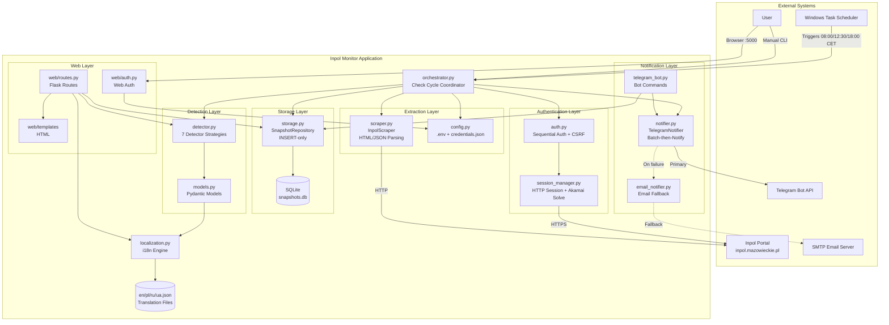
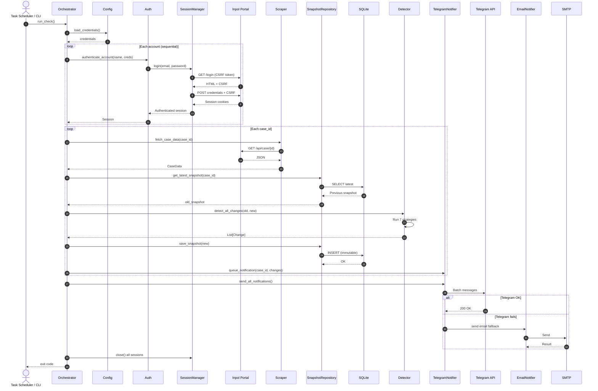
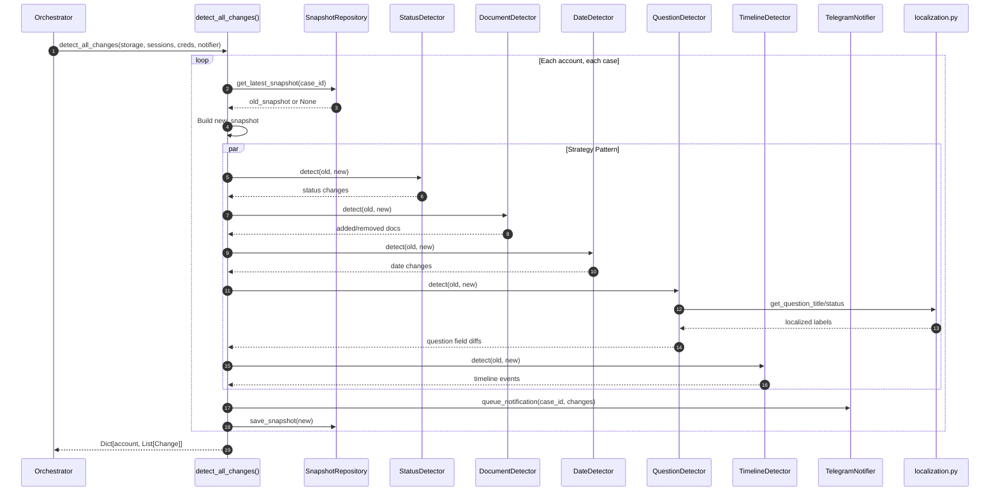
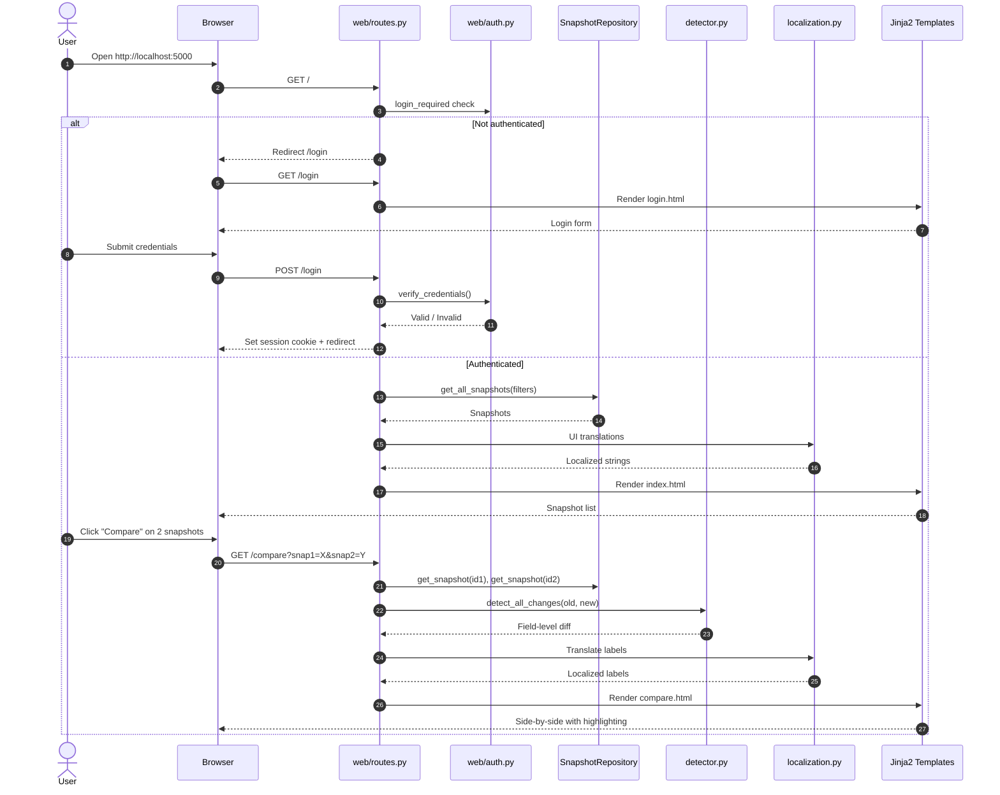
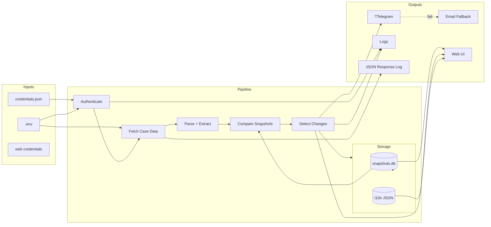
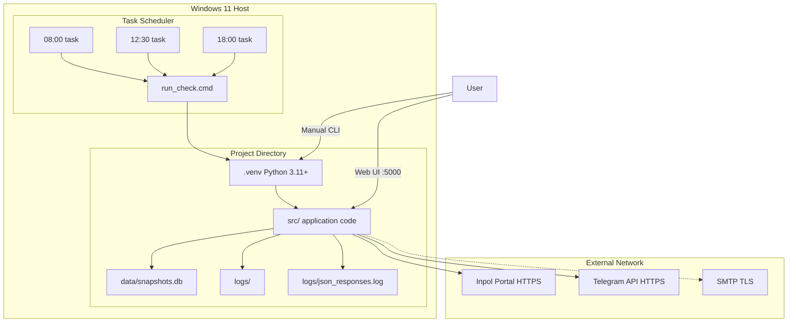

# Inpol Monitor — Architecture Diagrams

This document provides architectural component diagrams and interaction diagrams for the Inpol Monitor project. Diagrams use Mermaid syntax and render in GitHub, GitLab, VS Code, and any Mermaid-compatible viewer.

Available translations: [English](ARCHITECTURE.md) | [Polski](../pl/architecture/ARCHITECTURE.md) | [Русский](../ru/architecture/ARCHITECTURE.md) | [Українська](../ua/architecture/ARCHITECTURE.md)

---

## 1. Component Diagram

High-level view of the system's layers and their relationships.

---

## 2. Sequence Diagram — Main Check Cycle

The full monitoring cycle triggered by Task Scheduler, manual CLI, or the web UI.

---

## 3. Sequence Diagram — Change Detection Detail

Strategy-pattern detail for the 7 change types.

The 7 change types: `STATUS`, `NEW_DOCUMENT`, `REMOVED_DOCUMENT`, `DECISION_DATE_CHANGE`, `SUBMIT_DATE_CHANGE`, `UPDATED_AT_CHANGE`, `TIMELINE_EVENT_ADDED`, plus question-level types (`QUESTION_ASKED`, `QUESTION_ANSWERED`, `QUESTION_COUNT_CHANGE`, `NEW_QUESTION_DETAIL`).

---

## 4. Sequence Diagram — Web UI

Flask web app: login, snapshot list, side-by-side comparison.

Key routes (`src/web/routes.py`): `index`, `login`, `logout`, `compare`, `build_comparison`, `delete`, `set_language`.

---

## 5. Data Flow Summary

---

## 6. Deployment Architecture

---

## 7. Architectural Patterns

| Pattern | Location | Description |
|---------|----------|-------------|
| Strategy | `detector.py` | 7 detector classes implement `BaseDetector.detect(old, new)` |
| Repository | `storage.py` | `SnapshotRepository` abstracts SQLite CRUD |
| Batch-then-notify | `notifier.py` | Collect all changes, send one batched message |
| Fallback chain | `notifier.py` → `email_notifier.py` | Telegram primary, email fallback |
| INSERT-only immutability | `storage.py` | Snapshots never updated/deleted; full history |
| Dependency injection | `orchestrator.py` | Storage/notifier/sessions passed to detector |
| i18n with fallback | `localization.py` + `models.py` | JSON bundles + hardcoded fallback maps |
| Session management | `session_manager.py` | HTTP session + CSRF + Akamai meta-refresh solve |

---

## 8. Technology Stack

| Layer | Technology |
|-------|------------|
| Backend | Python 3.11+, requests, beautifulsoup4, lxml |
| Models | Pydantic v2 |
| Storage | SQLite (INSERT-only, immutable) |
| Web UI | Flask 3.0+, Bootstrap 5, HTMX, Jinja2 |
| Notifications | aiogram 3.x (Telegram), smtplib (SMTP) |
| Localization | JSON i18n (EN/PL/UA/RU) |
| Deployment | Windows Task Scheduler, Python venv |
| Testing | pytest, coverage >80% |

---

*Grounded in the actual codebase: `src/orchestrator.py`, `src/auth.py`, `src/session_manager.py`, `src/scraper.py`, `src/storage.py`, `src/detector.py`, `src/notifier.py`, `src/email_notifier.py`, `src/localization.py`, `src/models.py`, `src/web/routes.py`, `src/web/auth.py`.*
