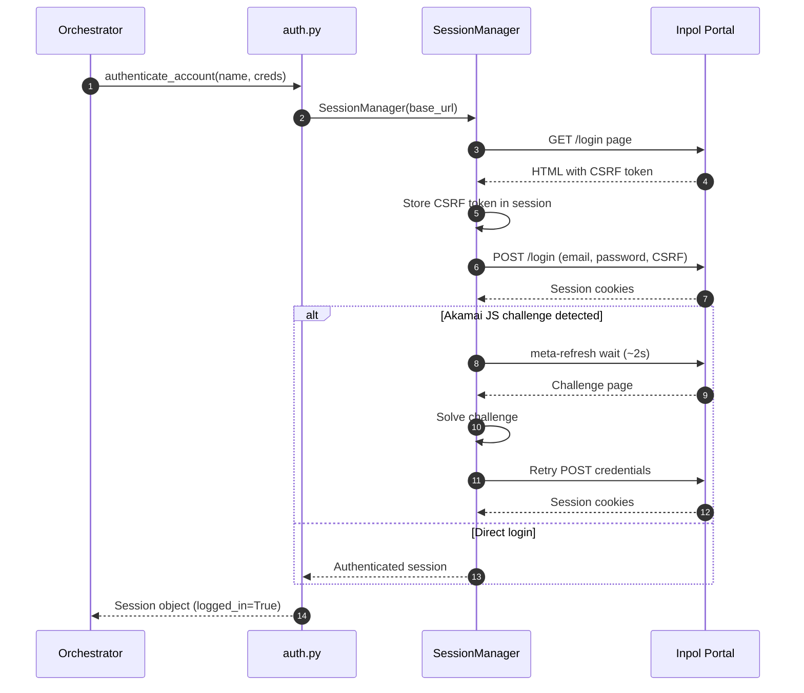
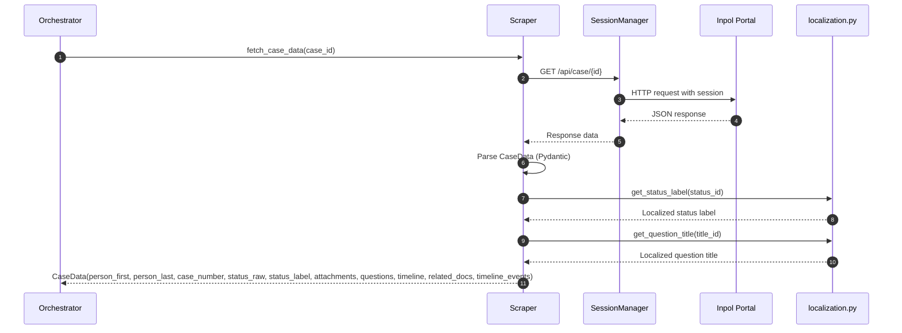
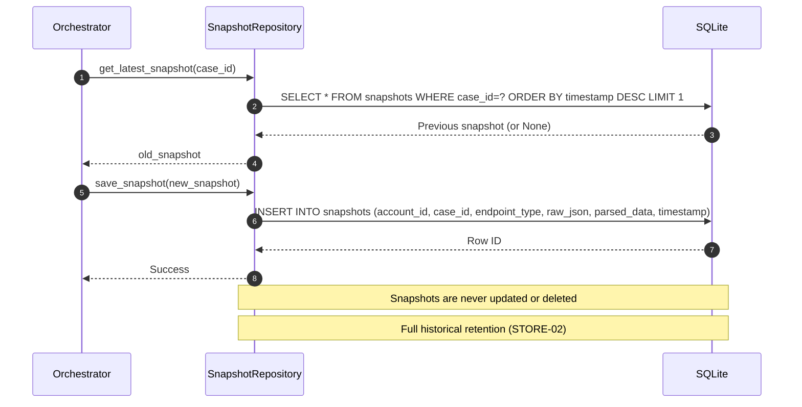
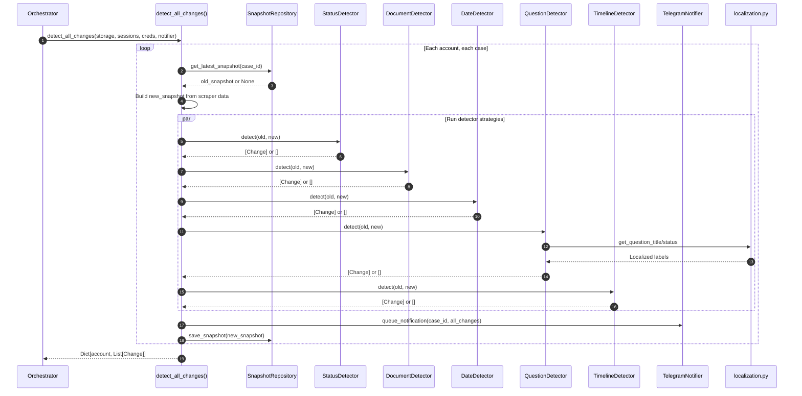
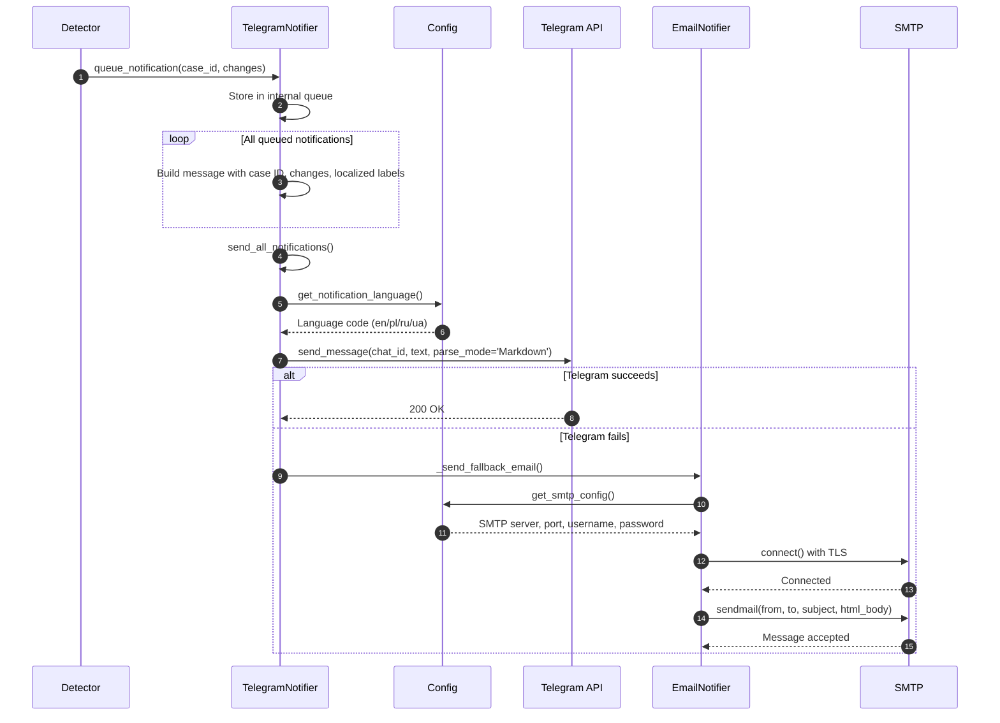
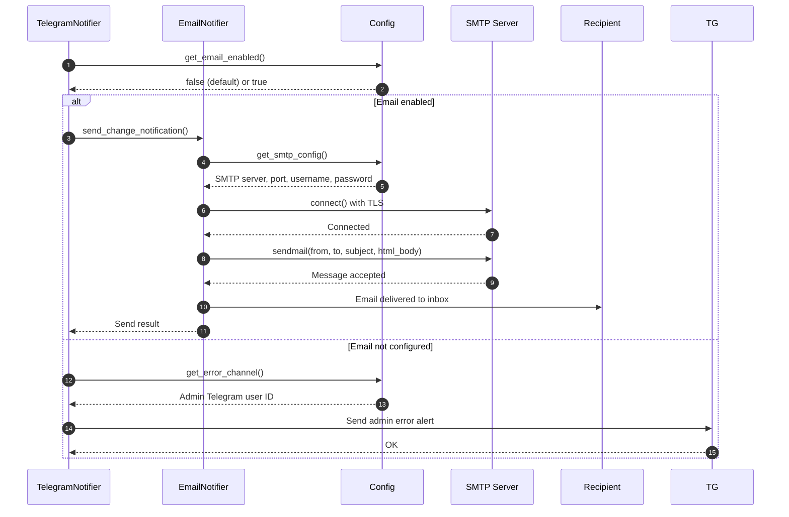
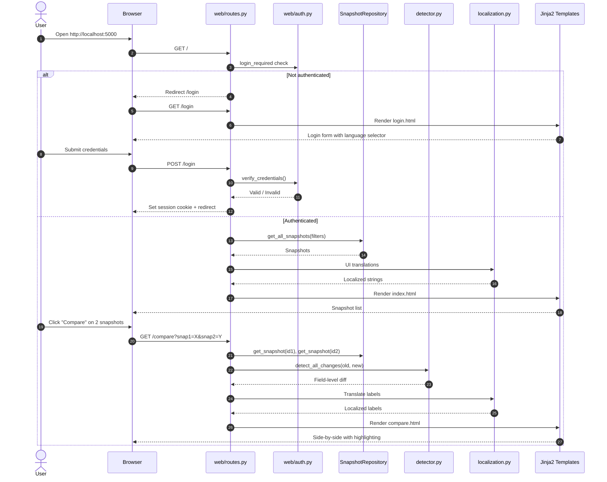
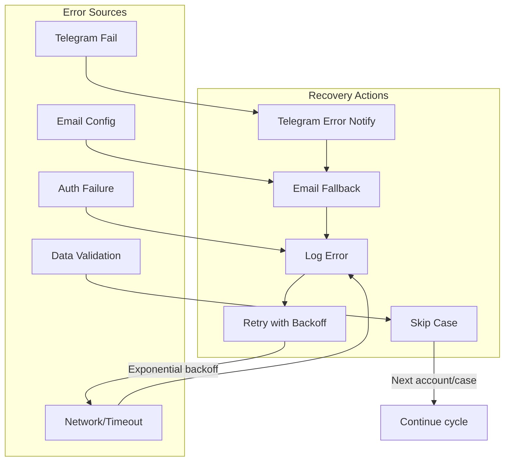
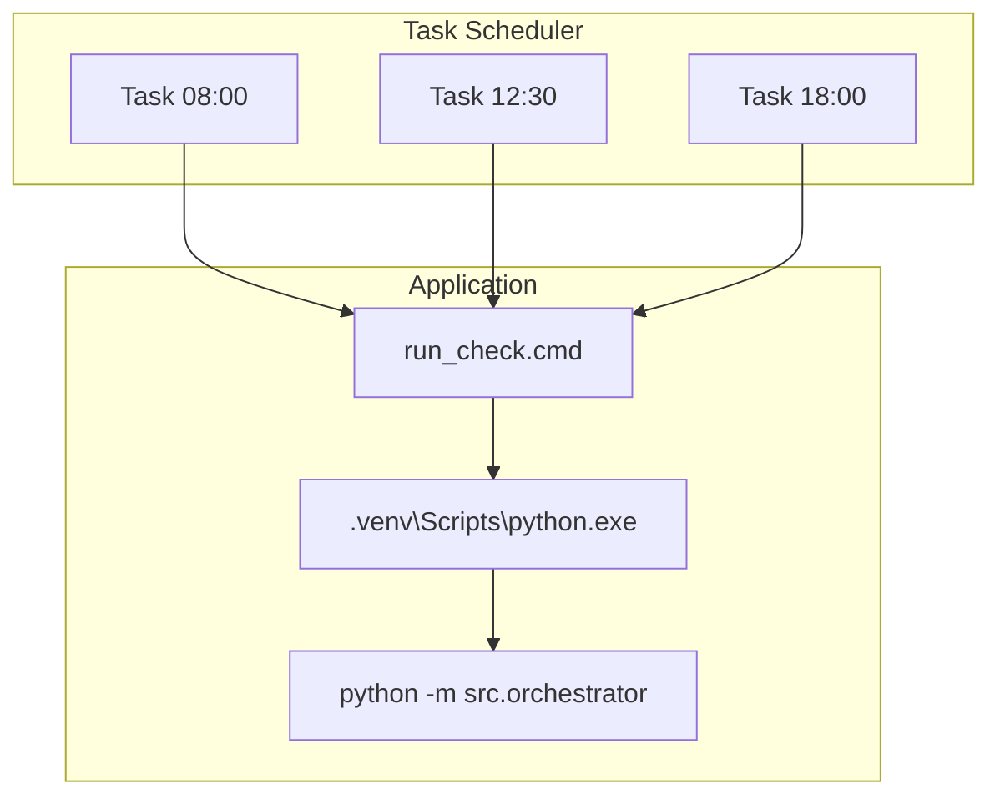

# Inpol Monitor — System Interaction Flows

Detailed interaction diagrams grounded in the actual codebase. All flows are derived from the implementation in `src/`, `.planning/`, and the application architecture.

Available translations: [English](SYSTEM_INTERACTIONS.md) | [Polski](../../pl/system-interactions/SYSTEM_INTERACTIONS.md) | [Русский](../../ru/system-interactions/SYSTEM_INTERACTIONS.md) | [Українська](../../ua/system-interactions/SYSTEM_INTERACTIONS.md)

---

## 1. Authentication Flow (Sequential Auth with CSRF)



**Key methods** (`src/auth.py`, `src/session_manager.py`):
- `authenticate_account(name, creds)` — sequential auth entry point
- `run_sequential_auth()` — processes all configured accounts
- `login(email, password)` — performs authentication
- `_has_akamai_challenge(html)` — detects Akamai protection
- `_solve_challenge(html, url)` — meta-refresh solver (~2s wait per API call)

---

## 2. Data Extraction Flow



**Key methods** (`src/scraper.py`):
- `fetch_case_data(case_id)` — extracts CaseData Pydantic model
- `fetch_questions(case_id)` — extracts question data with all 7 fields
- `fetch_attachments(case_id)` — extracts document attachments
- `_resolve_status_label(code)` — maps status codes to human-readable labels
- `_resolve_question_title(id)` — maps question titles via localization
- `fetch_all_for_case(case_id)` — orchestrates full case data fetch

---

## 3. Storage Flow (INSERT-only Immutable)



**Key methods** (`src/storage.py`):
- `save_snapshot(snapshot)` — INSERT-only, never update/delete
- `get_latest_snapshot(case_id)` — most recent snapshot per case
- `get_previous_snapshot(case_id)` — second-most-recent
- `get_all_snapshots()` — full historical records
- `get_snapshots_by_account(account_id)` — filter by account
- `get_distinct_case_ids()` — globally unique case IDs (STORE-03)
- `get_snapshot_by_id(id)` — single snapshot retrieval

---

## 4. Change Detection Flow (Strategy Pattern)



**7 change types** (`src/models.py` `ChangeType`):
- `STATUS` — status code changes
- `NEW_DOCUMENT` — new document added
- `REMOVED_DOCUMENT` — document removed
- `DECISION_DATE_CHANGE` — decision date modified
- `SUBMIT_DATE_CHANGE` — submission date modified
- `UPDATED_AT_CHANGE` — updated_at timestamp changed
- `TIMELINE_EVENT_ADDED` — new timeline event

Plus question-level types: `QUESTION_ASKED`, `QUESTION_ANSWERED`, `QUESTION_COUNT_CHANGE`, `NEW_QUESTION_DETAIL`.

**Key methods** (`src/detector.py`):
- `BaseDetector.detect(old, new)` — abstract strategy interface
- Each detector returns `List[Change]` (empty list if no changes)
- Graceful handling of `old_snapshot=None` (first run)

---

## 5. Telegram Notification Flow (Batch-then-Notify)



**Key methods** (`src/notifier.py`):
- `send_all_notifications()` — iterates all queued notifications
- `_build_change_message()` — rich Markdown message with case details
- `_build_single_message()` — single-case message
- `_build_error_message()` — error notification format
- `_send_fallback_email()` — triggers email fallback
- `_tn()` — localization helper for notification keys
- `_resolve_chat_id(user_id)` — maps user IDs to Telegram chat IDs

---

## 6. Email Fallback Flow



**Key methods** (`src/email_notifier.py`):
- `_validate_config()` — checks SMTP config exists
- `_format_change_email()` — HTML email body with before/after table
- `_format_error_email()` — error email body
- `send_change_notification()` — main entry point
- `send_combined_notification()` — batches all changes into one email

---

## 7. Web UI Flow (Flask)



**Key routes** (`src/web/routes.py`): `index`, `login`, `logout`, `compare`, `build_comparison`, `delete`, `set_language`.

**Key auth** (`src/web/auth.py`): `verify_credentials()`, `login_user()` / `logout_user()`, `login_required` decorator.

---

## 8. Localization / i18n Flow

```mermaid
flowchart TB
    subgraph LF[Language Files]
        EN[en.json]
        PL[pl.json]
        RU[ru.json]
        UA[ua.json]
    end

    subgraph L10N[Localization Engine]
        LOAD[load_translations(lang)]
        T[t(key, default, lang)]
        SL[get_status_label(id)]
        QT[get_question_title(id)]
        QS[get_question_status(id)]
        FT[get_file_type(id)]
    end

    subgraph FALLBACK[Fallback Maps]
        QTF[_QUESTION_TITLES_FALLBACK]
        QSF[_QUESTION_STATUSES_FALLBACK]
        SF[_STATUSES_FALLBACK]
    end

    LF -->|Read at startup| LOAD
    LOAD -->|Map to| FALLBACK
    LOAD -->|Override with| JSON mappings
    SL --> LOAD
    QT --> LOAD
    QS --> LOAD
    T --> LOAD
    FALLBACK -->|When JSON key missing| LOAD
```

**Key methods** (`src/localization.py`):
- `load_translations(language)` — loads JSON file for language code
- `t(key, default, language)` — translates a localization key
- `get_language()` / `set_language(lang)` — current language get/set
- `get_status_label(status_id)` — maps status code to translated label
- `get_question_title(title_id)` — maps title ID to translated label
- `get_question_status(status_id)` — maps status code to status label
- `get_file_type(file_type_id)` — maps file type ID to label

**Fallback mappings** (`src/models.py`):
- `_QUESTION_TITLES_FALLBACK` — 7 question titles
- `_QUESTION_STATUSES_FALLBACK` — 2 question statuses
- `_STATUSES_FALLBACK` — 22 status codes

---

## 9. Error Handling and Recovery Flow



**Error handling from the codebase:**

**From `src/orchestrator.py`:**
- `main()` wraps everything in try/except
- On error: `notifier.on_error(account_id, case_id, error, "SYSTEM_ERROR")`
- Error notification sent to Telegram

**From `src/notifier.py`:**
- `on_error()` — sends error notification to Telegram
- `_build_error_message()` — formats error details
- `_send_error_fallback_email()` — email fallback for errors

**From `src/session_manager.py`:**
- `get(url, max_retries=1)` — retry logic with `max_retries` parameter
- Akamai challenge auto-solve with meta-refresh (~2s wait)
- Error logging throughout

**From `src/detector.py`:**
- Each detector returns `List[Change]` (empty list if no changes)
- No exceptions thrown during normal detection
- Graceful handling of `old_snapshot=None` (first run scenario)

---

## 10. Configuration Flow

```mermaid
flowchart TD
    subgraph SRC[Sources]
        ENV[.env file]
        CRED[credentials.json]
        WEB[web credentials]
    end

    subgraph CFG[Config Module]
        LE[load_env(path)]
        LC[load_credentials(path)]
        GC[get_config(key, default)]
        GA[get_accounts()]
        GS[get_smtp_config()]
        GE[get_email_enabled()]
        GJ[get_json_logging_enabled()]
        GT[get_authorized_telegram_users()]
    end

    subgraph CONSUMERS[Consumers]
        ORCH[orchestrator.py]
        AUTH[auth.py]
        SCR[scraper.py]
        NOT[notifier.py]
        EM[email_notifier.py]
        STO[storage.py]
        WEBAPP[web/routes.py]
    end

    ENV --> LE
    CRED --> LC
    LE --> CFG
    LC --> CFG
    CFG --> CONSUMERS
```

**Key methods** (`src/config.py`):
- `load_env(path)` — loads .env file, returns success
- `load_credentials(path)` — loads credentials.json, returns dict
- `get_base_path()` — gets project base path
- `get_config(key, default)` — generic config lookup
- `get_accounts()` — lists configured account names
- `get_smtp_config()` — returns SMTP dict
- `get_email_enabled()` / `get_json_logging_enabled()` — booleans
- `get_authorized_telegram_users()` — list of authorized user IDs

**.env keys** (from README.md):
```
LANGUAGE=en                # Web UI language
NOTIFICATION_LANGUAGE=en   # Telegram/email notification language
INPOL_BASE_URL=https://inpol.mazowieckie.pl
JSON_LOGGING_ENABLED=false
EMAIL_ENABLED=false
SMTP_SERVER=smtp.example.com
SMTP_PORT=587
SMTP_USERNAME=your-username
SMTP_PASSWORD=your-password
EMAIL_FROM=noreply@example.com
EMAIL_TO=your-email@example.com
```

**credentials.json format** (from README.md):
```json
{
  "AccountName1": {
    "username": "email@example.com",
    "password": "secure-password",
    "case_ids": ["CASE-001", "CASE-002", "CASE-003"]
  },
  "AccountName2": {
    "username": "email2@example.com",
    "password": "another-password",
    "case_ids": ["CASE-004", "CASE-005"]
  }
}
```

---

## 11. Windows Task Scheduler Integration Flow



**Key commands** (from README.md and `run_check.cmd`):
- Full PowerShell command to create all 3 tasks:
  ```powershell
  $SCRIPT = Join-Path (Get-Location) "run_check.cmd"
  $TASK_NAME = "Inpol Monitor"

  schtasks /Create /TN $TASK_NAME /TR $SCRIPT /SC DAILY /ST 08:00 /F /RL HIGHEST
  schtasks /Create /TN "$TASK_NAME\Noon Check" /TR $SCRIPT /SC DAILY /ST 12:30 /F /RL HIGHEST
  schtasks /Create /TN "$TASK_NAME\Evening Check" /TR $SCRIPT /SC DAILY /ST 18:00 /F /RL HIGHEST
  ```
- Individual task queries and runs:
  ```cmd
  schtasks /Query /TN "Inpol Monitor"
  schtasks /Run /TN "Inpol Monitor"
  ```
- `run_check.cmd` content: `@cd %~dp0 & .venv\Scripts\python -m src.orchestrator`

---

*Grounded in the actual codebase: `src/orchestrator.py`, `src/auth.py`, `src/session_manager.py`, `src/scraper.py`, `src/storage.py`, `src/detector.py`, `src/notifier.py`, `src/email_notifier.py`, `src/localization.py`, `src/models.py`, `src/config.py`, `src/web/routes.py`, `src/web/auth.py`.*
