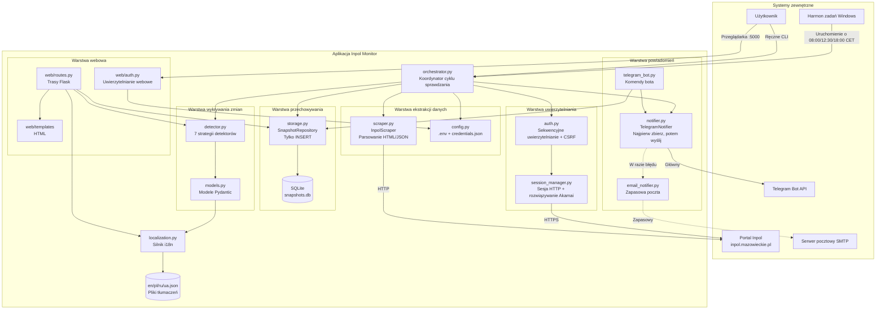
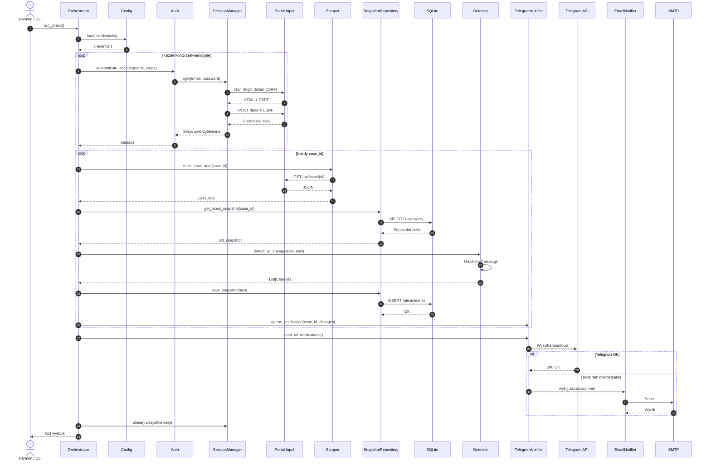
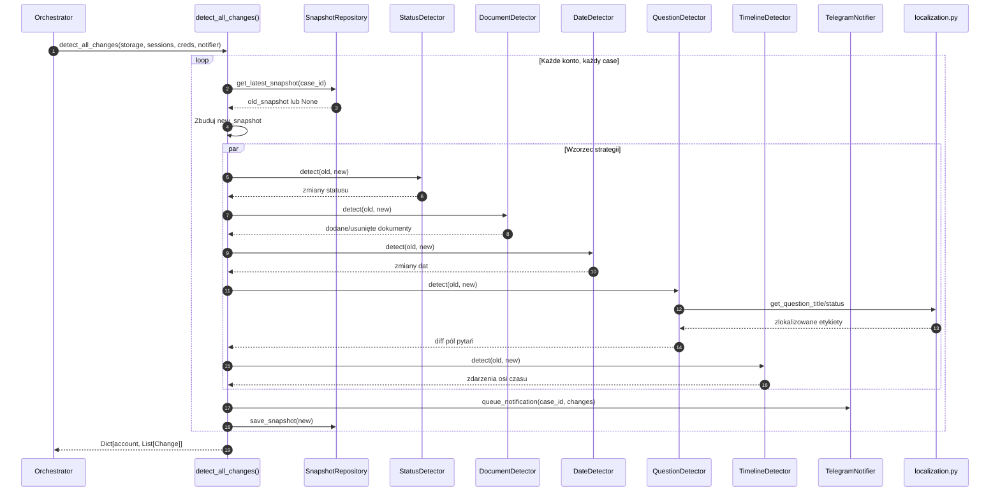
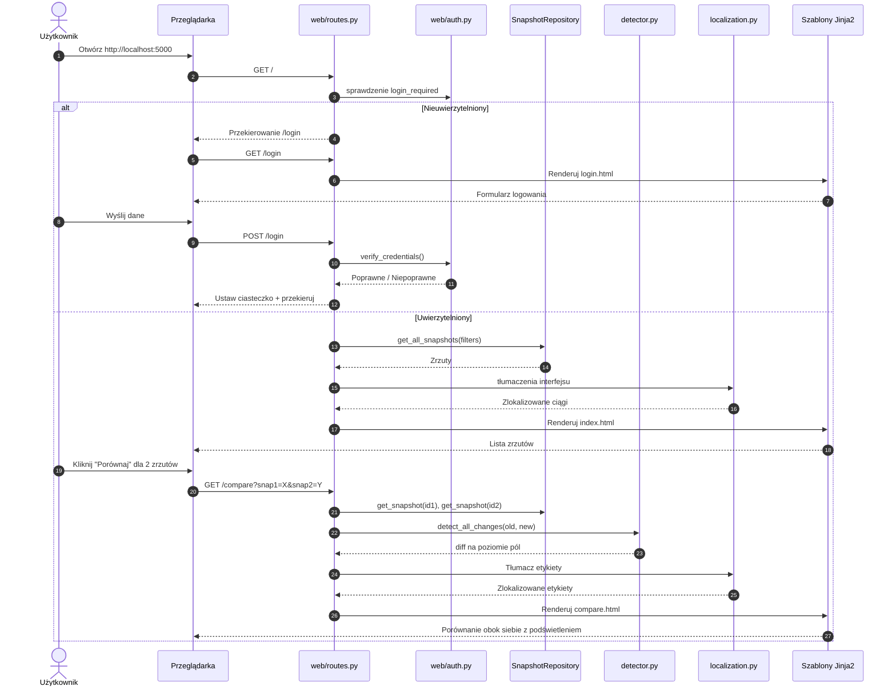
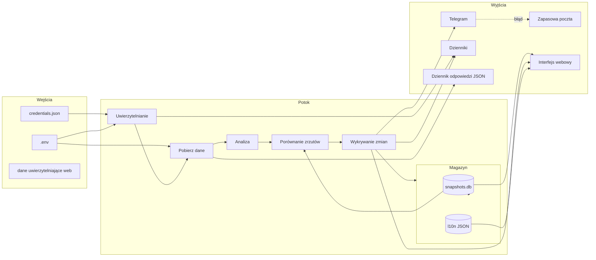
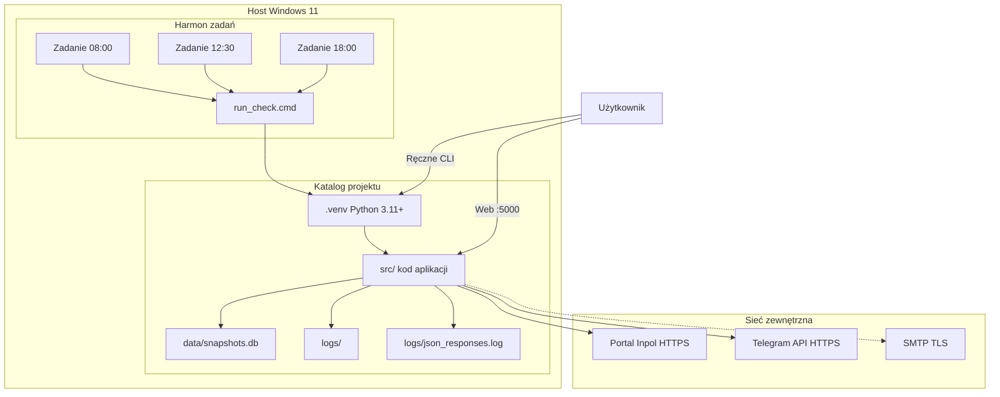

# Inpol Monitor — Diagramy architektury i interakcji

Ten dokument zawiera wizualne reprezentacje architektury systemu i interakcji między komponentami projektu Inpol Monitor. Diagramy używają składni Mermaid i renderują się w GitHub, GitLab, VS Code oraz w dowolnej przeglądarce kompatybilnej z Mermaid.

Dostępne tłumaczenia: [English](../en/architecture/ARCHITECTURE.md) | [Polski](ARCHITECTURE.md) | [Русский](../ru/architecture/ARCHITECTURE.md) | [Українська](../ua/architecture/ARCHITECTURE.md)

---

## 1. Diagram komponentów

Ogólny widok warstw systemu i relacji między nimi.

---

## 2. Diagram sekwencji — główny cykl sprawdzania

Pełny cykl monitoringu uruchamiany przez harmon zadań, ręczne CLI lub interfejs webowy.

---

## 3. Diagram sekwencji — szczegóły wykrywania zmian

Wzorzec strategii dla 7 typów zmian.

7 typów zmian: `STATUS`, `NEW_DOCUMENT`, `REMOVED_DOCUMENT`, `DECISION_DATE_CHANGE`, `SUBMIT_DATE_CHANGE`, `UPDATED_AT_CHANGE`, `TIMELINE_EVENT_ADDED`, a także typy poziomu pytań (`QUESTION_ASKED`, `QUESTION_ANSWERED`, `QUESTION_COUNT_CHANGE`, `NEW_QUESTION_DETAIL`).

---

## 4. Diagram sekwencji — interfejs webowy

Aplikacja webowa Flask: logowanie, lista zrzutów, porównanie dwóch zrzutów.

Kluczowe trasy (`src/web/routes.py`): `index`, `login`, `logout`, `compare`, `build_comparison`, `delete`, `set_language`.

---

## 5. Diagram przepływu danych

---

## 6. Architektura wdrożenia

---

## 7. Wzorce architektoniczne

| Wzorzec | Lokalizacja | Opis |
|---------|--------------|----------|
| Strategy | `detector.py` | 7 klas detektorów implementuje `BaseDetector.detect(old, new)` |
| Repository | `storage.py` | `SnapshotRepository` abstrahuje operacje SQLite |
| Najpierw zbierz, potem wyślij | `notifier.py` | Zbierz wszystkie zmiany, wyślij jedną wiadomość |
| Łańcuch zapasowy | `notifier.py` → `email_notifier.py` | Główny kanał — Telegram, zapasowy — poczta |
| Niemutowalność tylko INSERT | `storage.py` | Zrzuty nigdy nie są aktualizowane ani usuwane |
| Wstrzykiwanie zależności | `orchestrator.py` | Magazyn/powiadomiacz/sesje przekazywane detektorowi |
| i18n z zapasem | `localization.py` + `models.py` | Pakiety JSON + zaszyfrowane mapy zapasowe |
| Zarządzanie sesją | `session_manager.py` | Sesja HTTP + CSRF + rozwiązywanie challenge Akamai przez meta-refresh |

---

## 8. Stos technologiczny

| Warstwa | Technologia |
|------|------------|
| Backend | Python 3.11+, requests, beautifulsoup4, lxml |
| Modele | Pydantic v2 |
| Przechowywanie | SQLite (tylko INSERT, niezmienne) |
| Interfejs webowy | Flask 3.0+, Bootstrap 5, HTMX, Jinja2 |
| Powiadomienia | aiogram 3.x (Telegram), smtplib (SMTP) |
| Lokalizacja | JSON i18n (EN/PL/UA/RU) |
| Wdrożenie | Harmon zadań Windows, Python venv |
| Testowanie | pytest, pokrycie >80% |

---

*Oparte na prawdziwym kodzie: `src/orchestrator.py`, `src/auth.py`, `src/session_manager.py`, `src/scraper.py`, `src/storage.py`, `src/detector.py`, `src/notifier.py`, `src/email_notifier.py`, `src/localization.py`, `src/models.py`, `src/web/routes.py`, `src/web/auth.py`.*
