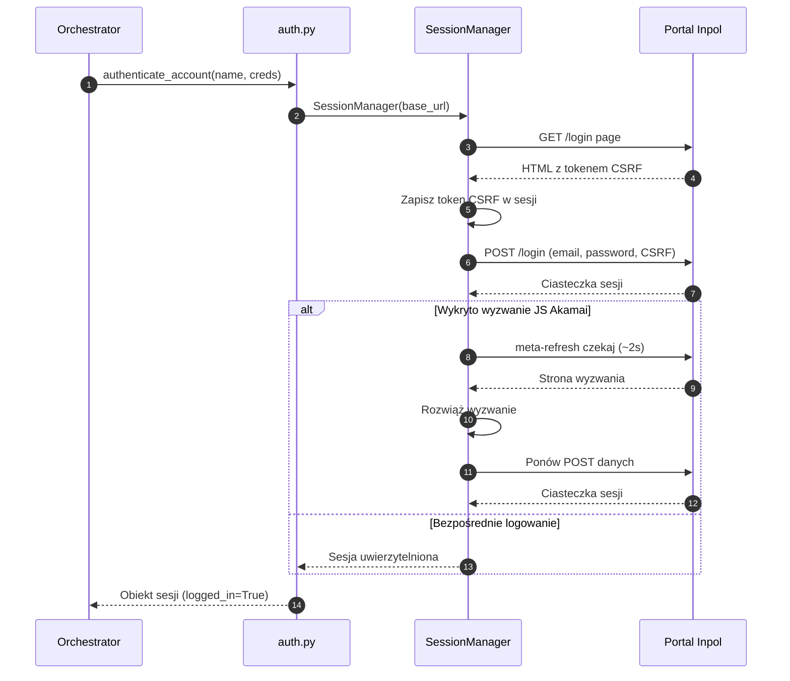
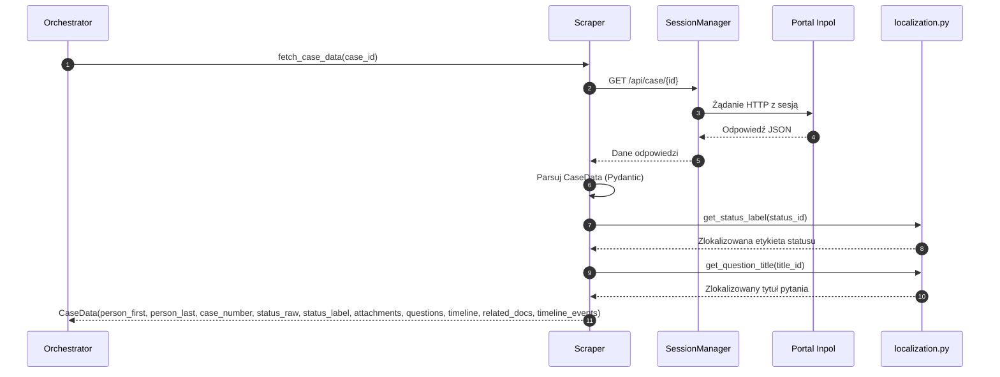
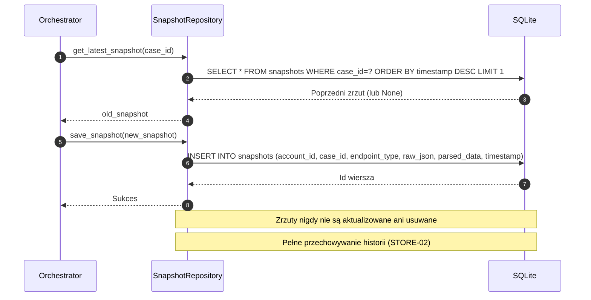
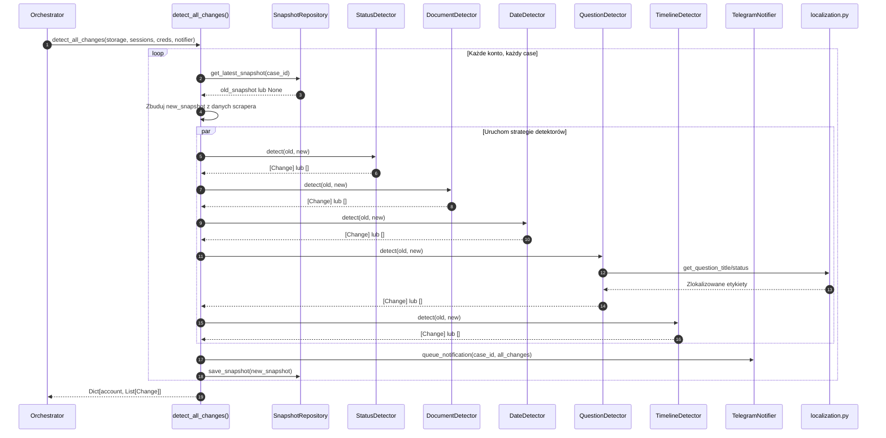
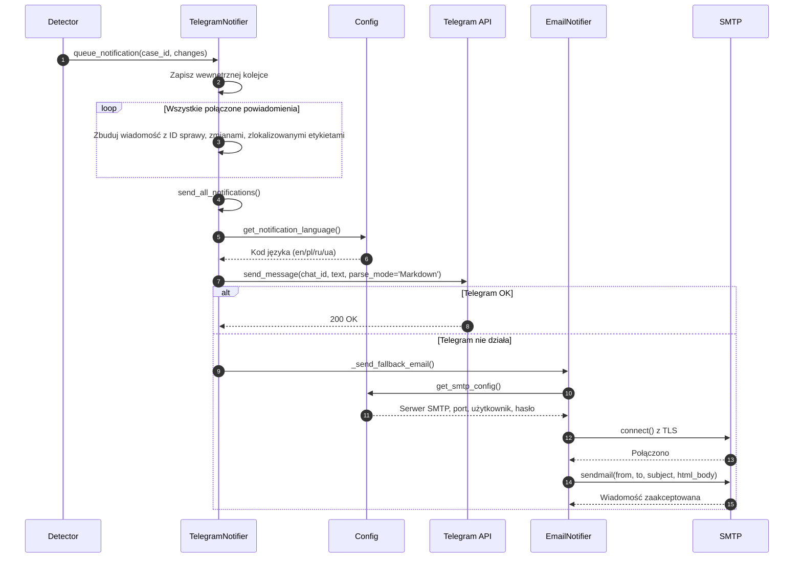
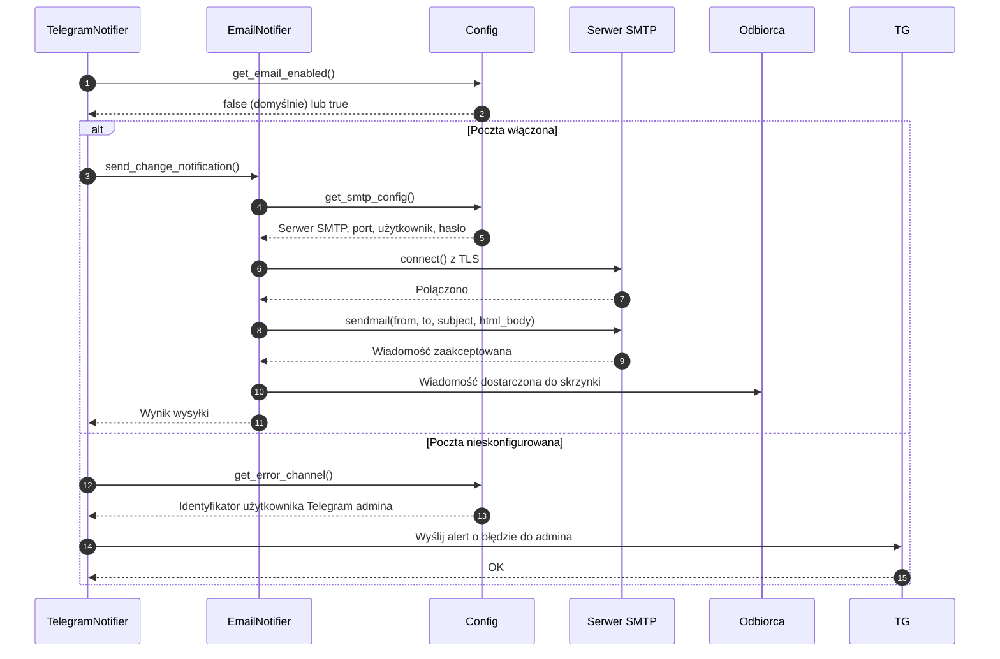
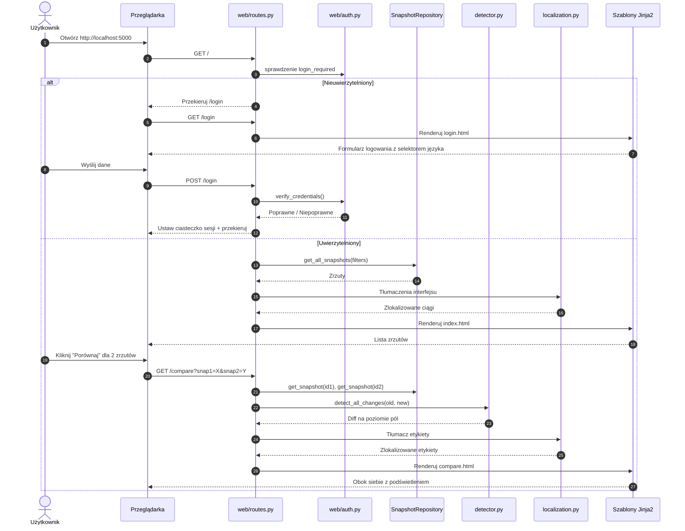
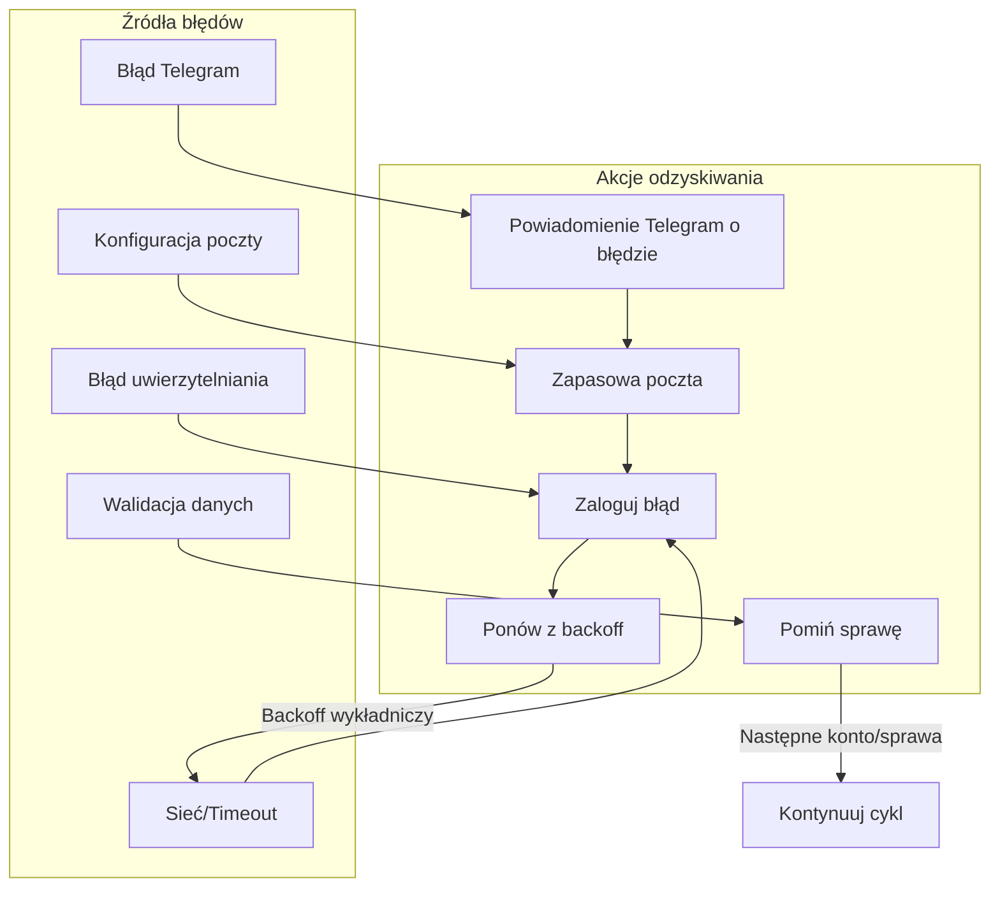
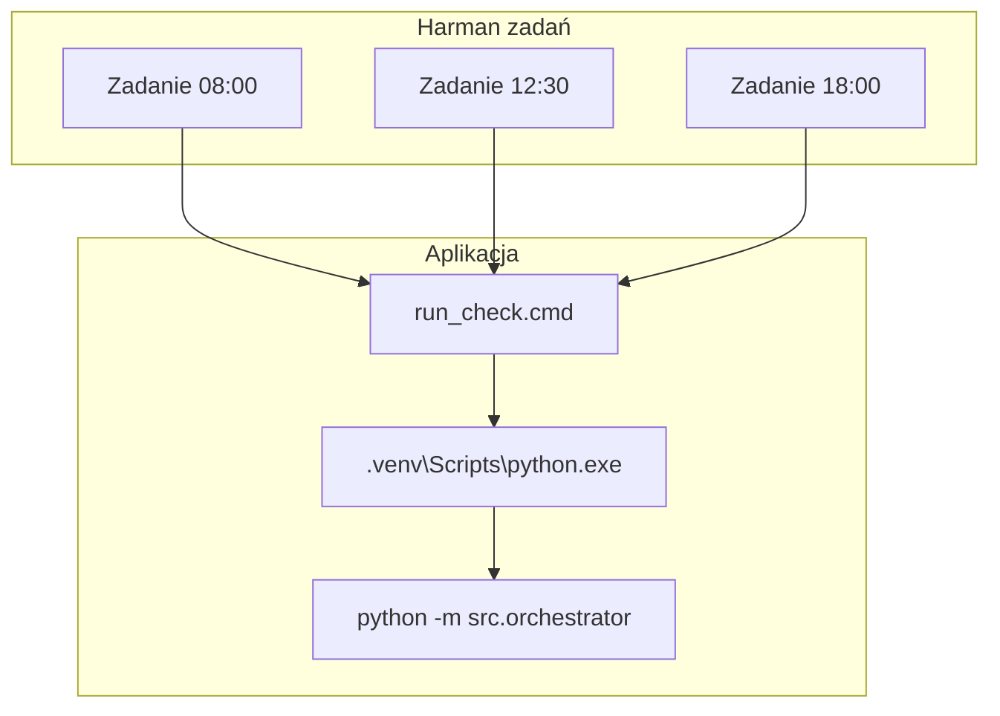

# Inpol Monitor — Diagramy interakcji systemu

Szczegółowe diagramy interakcji oparte na rzeczywistej bazie kodu. Wszystkie przepływy pochodzą z implementacji w `src/`, `.planning/` i architekturze aplikacji.

Dostępne tłumaczenia: [English](../../en/system-interactions/SYSTEM_INTERACTIONS.md) | [Polski](SYSTEM_INTERACTIONS.md) | [Русский](../../ru/system-interactions/SYSTEM_INTERACTIONS.md) | [Українська](../../ua/system-interactions/SYSTEM_INTERACTIONS.md)

---

## 1. Przepływ uwierzytelniania (sekwencyjne uwierzytelnianie z CSRF)



**Kluczowe metody** (`src/auth.py`, `src/session_manager.py`):
- `authenticate_account(name, creds)` — punkt wejścia sekwencyjnego uwierzytelniania
- `run_sequential_auth()` — przetwarza wszystkie skonfigurowane konta
- `login(email, password)` — wykonuje uwierzytelnianie
- `_has_akamai_challenge(html)` — wykrywa ochronę Akamai
- `_solve_challenge(html, url)` — rozwiązywacz meta-refresh (~2s czekania na wywołanie API)

---

## 2. Przepływ ekstrakcji danych



**Kluczowe metody** (`src/scraper.py`):
- `fetch_case_data(case_id)` — wyodrębnia model CaseData Pydantic
- `fetch_questions(case_id)` — wyodrębnia dane pytań ze wszystkimi 7 polami
- `fetch_attachments(case_id)` — wyodrębnia załączniki dokumentów
- `_resolve_status_label(code)` — mapuje kody statusów na etykiety czytelne dla człowieka
- `_resolve_question_title(id)` — mapuje tytuły pytań przez lokalizację
- `fetch_all_for_case(case_id)` — koordynuje pełne pobranie danych sprawy

---

## 3. Przepływ przechowywania (tylko INSERT, niezmienne)



**Kluczowe metody** (`src/storage.py`):
- `save_snapshot(snapshot)` — tylko INSERT, nigdy nie aktualizuje/usuwa
- `get_latest_snapshot(case_id)` — najnowszy zrzut dla sprawy
- `get_previous_snapshot(case_id)` — drugi najnowszy
- `get_all_snapshots()` — pełne historyczne rekordy
- `get_snapshots_by_account(account_id)` — filtruj po koncie
- `get_distinct_case_ids()` — globalnie unikalne identyfikatory spraw (STORE-03)
- `get_snapshot_by_id(id)` — pobieranie pojedynczego zrzutu

---

## 4. Przepływ wykrywania zmian (wzorzec strategii)



**7 typów zmian** (`src/models.py` `ChangeType`):
- `STATUS` — zmiana kodu statusu
- `NEW_DOCUMENT` — dodano nowy dokument
- `REMOVED_DOCUMENT` — usunięto dokument
- `DECISION_DATE_CHANGE` — zmieniono datę decyzji
- `SUBMIT_DATE_CHANGE` — zmieniono datę złożenia
- `UPDATED_AT_CHANGE` — zmieniono znacznik czasu updated_at
- `TIMELINE_EVENT_ADDED` — nowe zdarzenie na osi czasu

Oraz typy poziomu pytań: `QUESTION_ASKED`, `QUESTION_ANSWERED`, `QUESTION_COUNT_CHANGE`, `NEW_QUESTION_DETAIL`.

**Kluczowe metody** (`src/detector.py`):
- `BaseDetector.detect(old, new)` — abstrakcyjny interfejs strategii
- Każdy detektor zwraca `List[Change]` (pusta lista, gdy brak zmian)
- Łagodne obsługiwanie `old_snapshot=None` (pierwsze uruchomienie)

---

## 5. Przepływ powiadomień Telegram (najpierw zbierz, potem wyślij)



**Kluczowe metody** (`src/notifier.py`):
- `send_all_notifications()` — iteruje po wszystkich powiadomieniach w kolejce
- `_build_change_message()` — bogata wiadomość Markdown ze szczegółami sprawy
- `_build_single_message()` — wiadomość pojedynczej sprawy
- `_build_error_message()` — format powiadomienia o błędzie
- `_send_fallback_email()` — uruchamia zapasową pocztę
- `_tn()` — pomocnik lokalizacji dla kluczy powiadomień
- `_resolve_chat_id(user_id)` — mapuje identyfikatory użytkowników na czaty Telegram

---

## 6. Przepływ zapasowej poczty



**Kluczowe metody** (`src/email_notifier.py`):
- `_validate_config()` — sprawdza czy konfiguracja SMTP istnieje
- `_format_change_email()` — treść HTML z tabelą przed/po
- `_format_error_email()` — treść powiadomienia o błędzie
- `send_change_notification()` — główny punkt wejścia
- `send_combined_notification()` — łączy wszystkie zmiany w jednym mailu

---

## 7. Przepływ interfejsu webowego (Flask)



**Kluczowe trasy** (`src/web/routes.py`): `index`, `login`, `logout`, `compare`, `build_comparison`, `delete`, `set_language`.

**Kluczowa autentykacja** (`src/web/auth.py`): `verify_credentials()`, `login_user()` / `logout_user()`, dekorator `login_required`.

---

## 8. Przepływ lokalizacji / i18n

```mermaid
flowchart TB
    subgraph LF[Pliki językowe]
        EN[en.json]
        PL[pl.json]
        RU[ru.json]
        UA[ua.json]
    end

    subgraph L10N[Silnik lokalizacji]
        LOAD[load_translations(lang)]
        T[t(key, default, lang)]
        SL[get_status_label(id)]
        QT[get_question_title(id)]
        QS[get_question_status(id)]
        FT[get_file_type(id)]
    end

    subgraph FALLBACK[Mapy zapasowe]
        QTF[_QUESTION_TITLES_FALLBACK]
        QSF[_QUESTION_STATUSES_FALLBACK]
        SF[_STATUSES_FALLBACK]
    end

    LF -->|Czytaj przy starcie| LOAD
    LOAD -->|Mapuj na| FALLBACK
    LOAD -->|Nadpisz za pomocą| Mapowania JSON
    SL --> LOAD
    QT --> LOAD
    QS --> LOAD
    T --> LOAD
    FALLBACK -->|Gdy klucz JSON brakny| LOAD
```

**Kluczowe metody** (`src/localization.py`):
- `load_translations(language)` — ładuje plik JSON dla kodu języka
- `t(key, default, language)` — tłumaczy klucz lokalizacji
- `get_language()` / `set_language(lang)` — pobranie/ustawienie bieżącego języka
- `get_status_label(status_id)` — mapuje kod statusu na przetłumaczoną etykietę
- `get_question_title(title_id)` — mapuje identyfikator tytułu na przetłumaczoną etykietę
- `get_question_status(status_id)` — mapuje kod statusu na etykietę statusu
- `get_file_type(file_type_id)` — mapuje identyfikator typu pliku na etykietę

**Mapy zapasowe** (`src/models.py`):
- `_QUESTION_TITLES_FALLBACK` — 7 tytułów pytań
- `_QUESTION_STATUSES_FALLBACK` — 2 statusy pytań
- `_STATUSES_FALLBACK` — 22 kody statusów

---

## 9. Przepływ obsługi błędów i odzyskiwania



**Obsługa błędów z bazy kodu:**

**Z `src/orchestrator.py`:**
- `main()` owija wszystko w try/except
- W razie błędu: `notifier.on_error(account_id, case_id, error, "SYSTEM_ERROR")`
- Powiadomienie o błędzie wysyłane do Telegrama

**Z `src/notifier.py`:**
- `on_error()` — wysyła powiadomienie o błędzie do Telegrama
- `_build_error_message()` — formatuje szczegóły błędu
- `_send_error_fallback_email()` — zapasowa poczta dla błędów

**Z `src/session_manager.py`:**
- `get(url, max_retries=1)` — logika ponawiania z parametrem `max_retries`
- Automatyczne rozwiązywanie wyzwań Akamai przez meta-refresh (~2s oczekiwania)
- Rejestrowanie błędów w całej aplikacji

**Z `src/detector.py`:**
- Każdy detektor zwraca `List[Change]` (pusta lista, gdy brak zmian)
- Brak wyjątków podczas normalnej detekcji
- Łagodne obsługiwanie `old_snapshot=None` (scenariusz pierwszego uruchomienia)

---

## 10. Przepływ konfiguracji

```mermaid
flowchart TD
    subgraph SRC[Źródła]
        ENV[Plik .env]
        CRED[credentials.json]
        WEB[dane uwierzytelniające web]
    end

    subgraph CFG[Moduł konfiguracji]
        LE[load_env(path)]
        LC[load_credentials(path)]
        GC[get_config(key, default)]
        GA[get_accounts()]
        GS[get_smtp_config()]
        GE[get_email_enabled()]
        GJ[get_json_logging_enabled()]
        GT[get_authorized_telegram_users()]
    end

    subgraph CONSUMERS[Konsumenci]
        ORCH[orchestrator.py]
        AUTH[auth.py]
        SCR[scraper.py]
        NOT[notifier.py]
        EM[email_notifier.py]
        STO[storage.py]
        WEBAPP[web/routes.py]
    end

    ENV --> LE
    CRED --> LC
    LE --> CFG
    LC --> CFG
    CFG --> CONSUMERS
```

**Kluczowe metody** (`src/config.py`):
- `load_env(path)` — ładuje plik .env, zwraca sukces
- `load_credentials(path)` — ładuje credentials.json, zwraca słownik
- `get_base_path()` — pobiera bazową ścieżkę projektu
- `get_config(key, default)` — ogólne wyszukiwanie konfiguracji
- `get_accounts()` — listuje nazwy skonfigurowanych kont
- `get_smtp_config()` — zwraca słownik SMTP
- `get_email_enabled()` / `get_json_logging_enabled()` — wartości logiczne
- `get_authorized_telegram_users()` — lista autoryzowanych identyfikatorów użytkowników

**Klucze .env** (z README.md):
```
LANGUAGE=en                # Język interfejsu web
NOTIFICATION_LANGUAGE=en   # Język powiadomień Telegram/poczta
INPOL_BASE_URL=https://inpol.mazowieckie.pl
JSON_LOGGING_ENABLED=false
EMAIL_ENABLED=false
SMTP_SERVER=smtp.example.com
SMTP_PORT=587
SMTP_USERNAME=your-username
SMTP_PASSWORD=your-password
EMAIL_FROM=noreply@example.com
EMAIL_TO=your-email@example.com
```

**Format credentials.json** (z README.md):
```json
{
  "AccountName1": {
    "username": "email@example.com",
    "password": "secure-password",
    "case_ids": ["CASE-001", "CASE-002", "CASE-003"]
  },
  "AccountName2": {
    "username": "email2@example.com",
    "password": "another-password",
    "case_ids": ["CASE-004", "CASE-005"]
  }
}
```

---

## 11. Przepływ integracji z Harmanem zadań Windows



**Kluczowe komendy** (z README.md i `run_check.cmd`):
- Pełne polecenie PowerShell do utworzenia wszystkich 3 zadań:
  ```powershell
  $SCRIPT = Join-Path (Get-Location) "run_check.cmd"
  $TASK_NAME = "Inpol Monitor"

  schtasks /Create /TN $TASK_NAME /TR $SCRIPT /SC DAILY /ST 08:00 /F /RL HIGHEST
  schtasks /Create /TN "$TASK_NAME\Noon Check" /TR $SCRIPT /SC DAILY /ST 12:30 /F /RL HIGHEST
  schtasks /Create /TN "$TASK_NAME\Evening Check" /TR $SCRIPT /SC DAILY /ST 18:00 /F /RL HIGHEST
  ```
- Pojedyncze zapytania i uruchomienia zadań:
  ```cmd
  schtasks /Query /TN "Inpol Monitor"
  schtasks /Run /TN "Inpol Monitor"
  ```
- Zawartość `run_check.cmd`: `@cd %~dp0 & .venv\Scripts\python -m src.orchestrator`

---

*Oparte na rzeczywistym kodzie: `src/orchestrator.py`, `src/auth.py`, `src/session_manager.py`, `src/scraper.py`, `src/storage.py`, `src/detector.py`, `src/notifier.py`, `src/email_notifier.py`, `src/localization.py`, `src/models.py`, `src/config.py`, `src/web/routes.py`, `src/web/auth.py`.*
