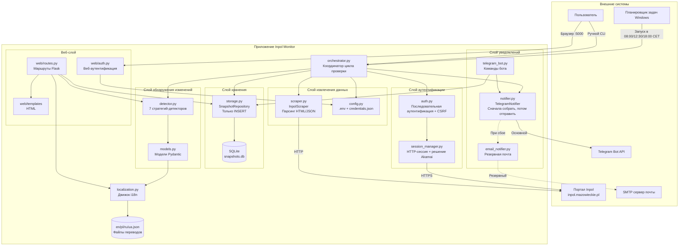
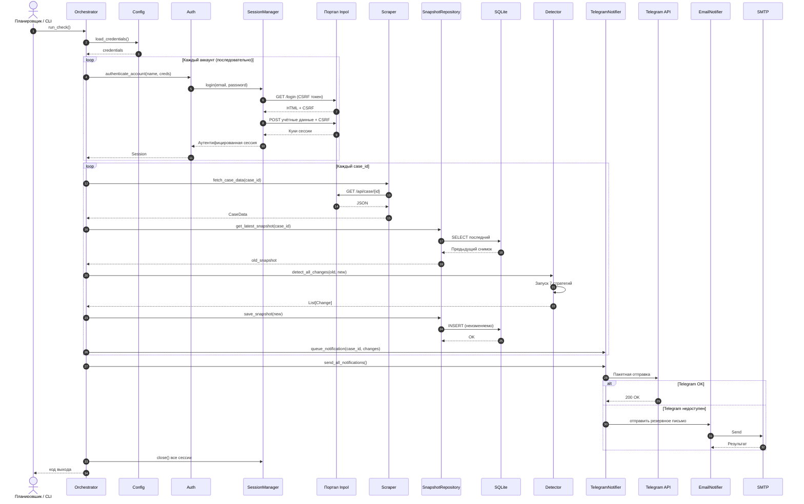
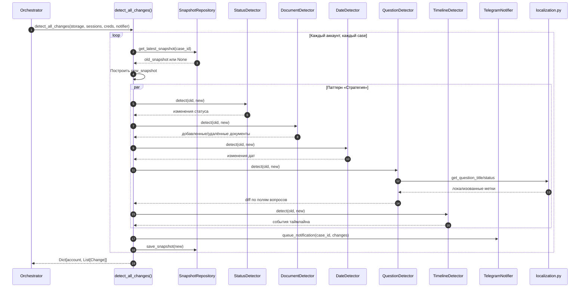
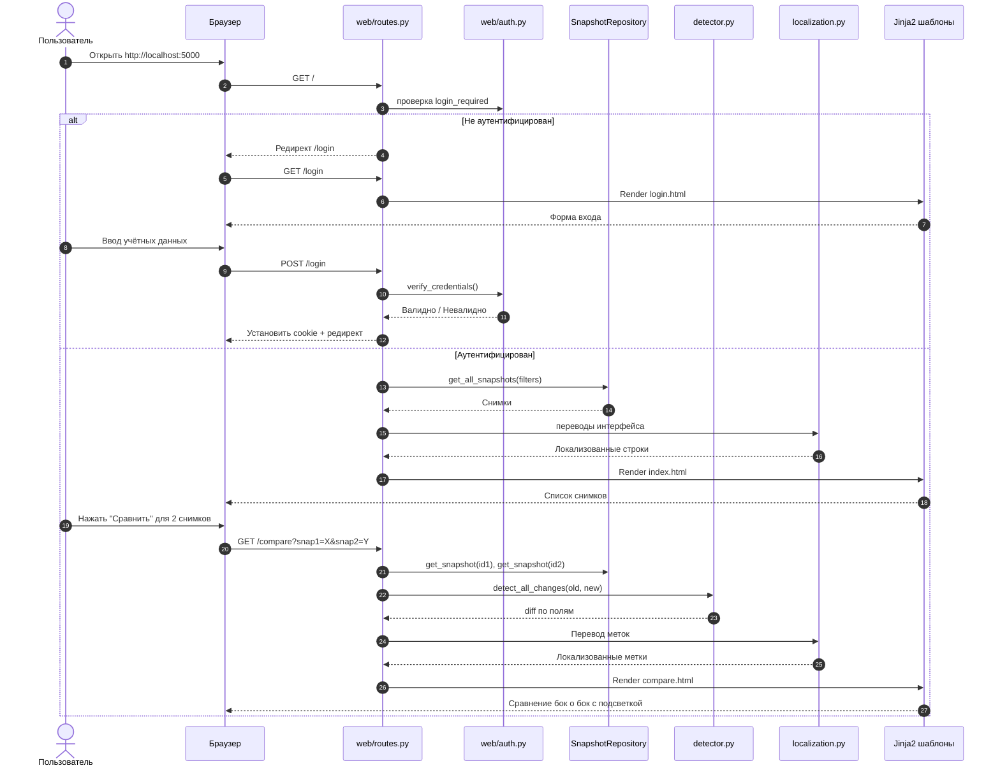
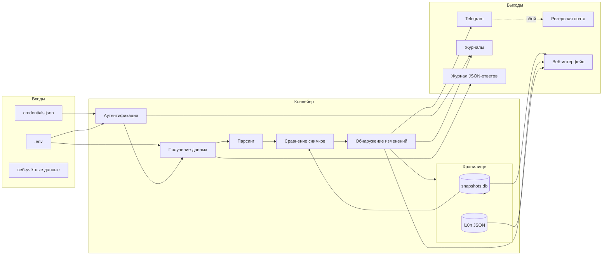
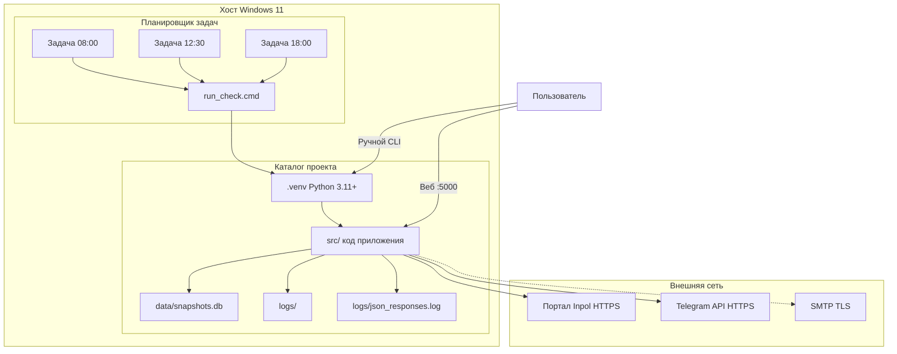

# Inpol Monitor — Диаграммы архитектуры и взаимодействий

Этот документ содержит визуальные представления архитектуры системы и взаимодействия между компонентами проекта Inpol Monitor. Диаграммы используют синтаксис Mermaid и отображаются в GitHub, GitLab, VS Code и любом совместимом с Mermaid просмотрщике.

Доступные переводы: [English](../../en/architecture/ARCHITECTURE.md) | [Polski](../../pl/architecture/ARCHITECTURE.md) | [Русский](ARCHITECTURE.md) | [Українська](../../ua/architecture/ARCHITECTURE.md)

---

## 1. Диаграмма компонентов

Общий вид слоёв системы и связей между ними.

---

## 2. Диаграмма последовательности — основной цикл проверки

Полный цикл мониторинга, запускаемый планировщиком задач, ручным CLI или веб-интерфейсом.

---

## 3. Диаграмма последовательности — детали обнаружения изменений

Паттерн «Стратегия» для 7 типов изменений.

7 типов изменений: `STATUS`, `NEW_DOCUMENT`, `REMOVED_DOCUMENT`, `DECISION_DATE_CHANGE`, `SUBMIT_DATE_CHANGE`, `UPDATED_AT_CHANGE`, `TIMELINE_EVENT_ADDED`, а также типы уровня вопросов (`QUESTION_ASKED`, `QUESTION_ANSWERED`, `QUESTION_COUNT_CHANGE`, `NEW_QUESTION_DETAIL`).

---

## 4. Диаграмма последовательности — веб-интерфейс

Веб-приложение Flask: вход, список снимков, сравнение двух снимков.

Ключевые маршруты (`src/web/routes.py`): `index`, `login`, `logout`, `compare`, `build_comparison`, `delete`, `set_language`.

---

## 5. Сводка потока данных

---

## 6. Архитектура развёртывания

---

## 7. Архитектурные паттерны

| Паттерн | Расположение | Описание |
|---------|--------------|----------|
| Strategy | `detector.py` | 7 классов-детекторов реализуют `BaseDetector.detect(old, new)` |
| Repository | `storage.py` | `SnapshotRepository` абстрагирует операции SQLite |
| Сначала собрать, потом отправить | `notifier.py` | Собрать все изменения, отправить одним сообщением |
| Цепочка резервов | `notifier.py` → `email_notifier.py` | Основной канал — Telegram, резервный — почта |
| Неизменяемость только INSERT | `storage.py` | Снимки никогда не обновляются и не удаляются |
| Внедрение зависимостей | `orchestrator.py` | Хранилище/уведомитель/сессии передаются детектору |
| i18n с резервом | `localization.py` + `models.py` | JSON-словари + жёстко заданные резервные соответствия |
| Управление сессией | `session_manager.py` | HTTP-сессия + CSRF + решение challenge Akamai через meta-refresh |

---

## 8. Технологический стек

| Слой | Технология |
|------|------------|
| Бэкенд | Python 3.11+, requests, beautifulsoup4, lxml |
| Модели | Pydantic v2 |
| Хранение | SQLite (только INSERT, неизменяемо) |
| Веб-интерфейс | Flask 3.0+, Bootstrap 5, HTMX, Jinja2 |
| Уведомления | aiogram 3.x (Telegram), smtplib (SMTP) |
| Локализация | JSON i18n (EN/PL/UA/RU) |
| Развёртывание | Планировщик задач Windows, Python venv |
| Тестирование | pytest, покрытие >80% |

---

*На основе реального кода: `src/orchestrator.py`, `src/auth.py`, `src/session_manager.py`, `src/scraper.py`, `src/storage.py`, `src/detector.py`, `src/notifier.py`, `src/email_notifier.py`, `src/localization.py`, `src/models.py`, `src/web/routes.py`, `src/web/auth.py`.*
