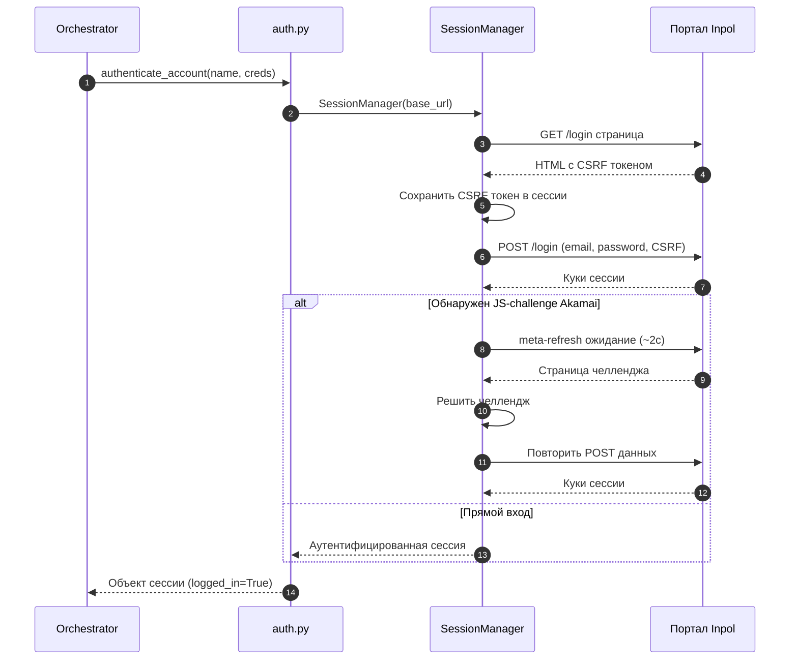
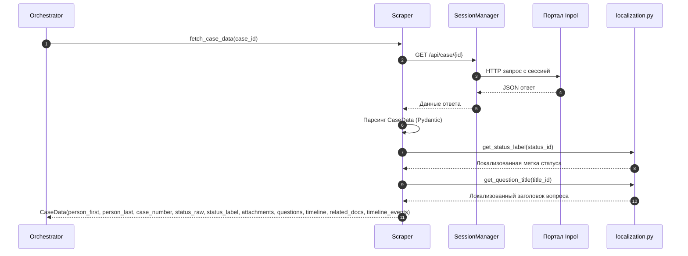
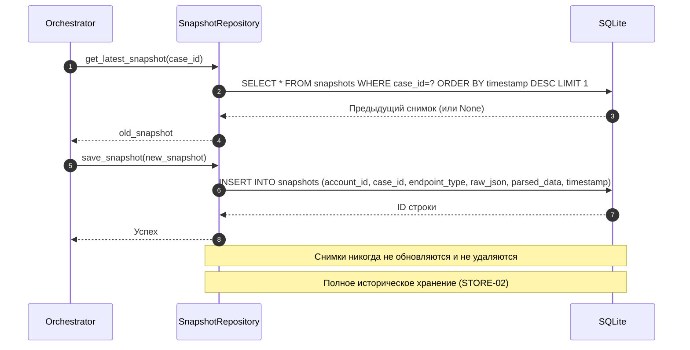
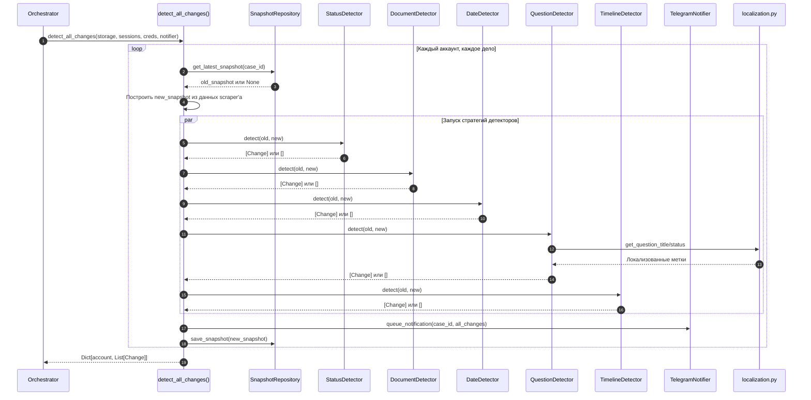
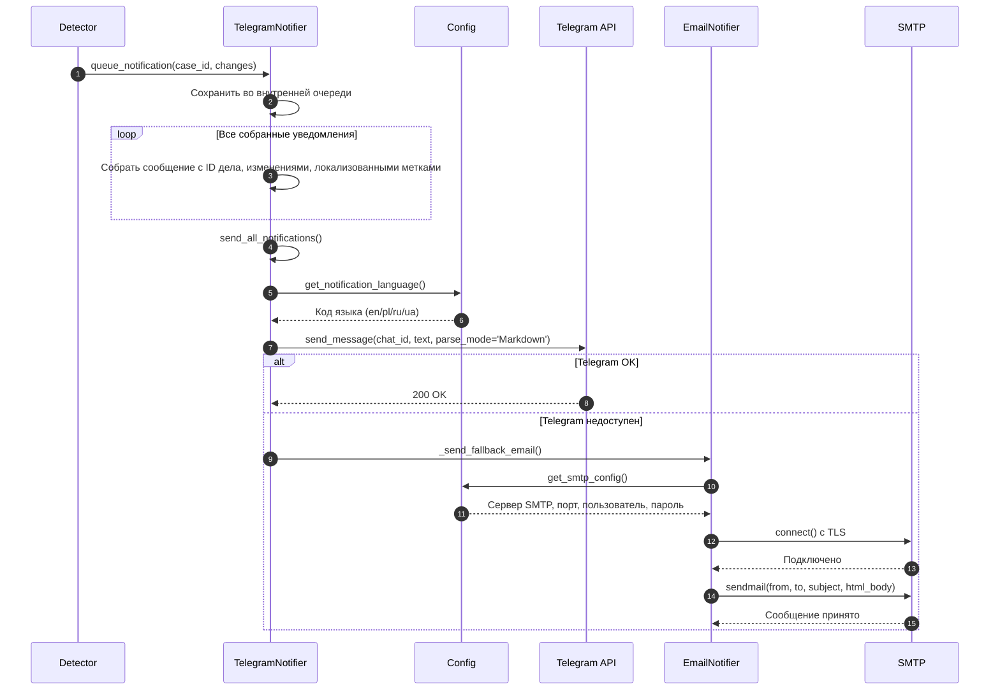
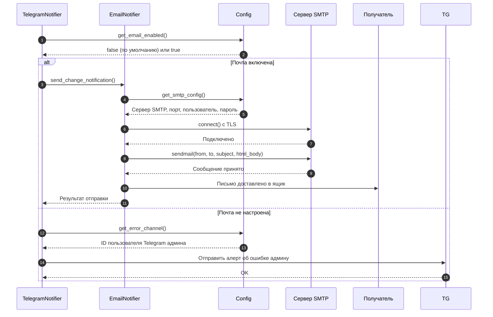
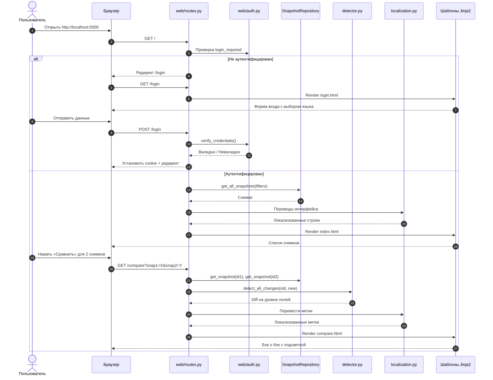
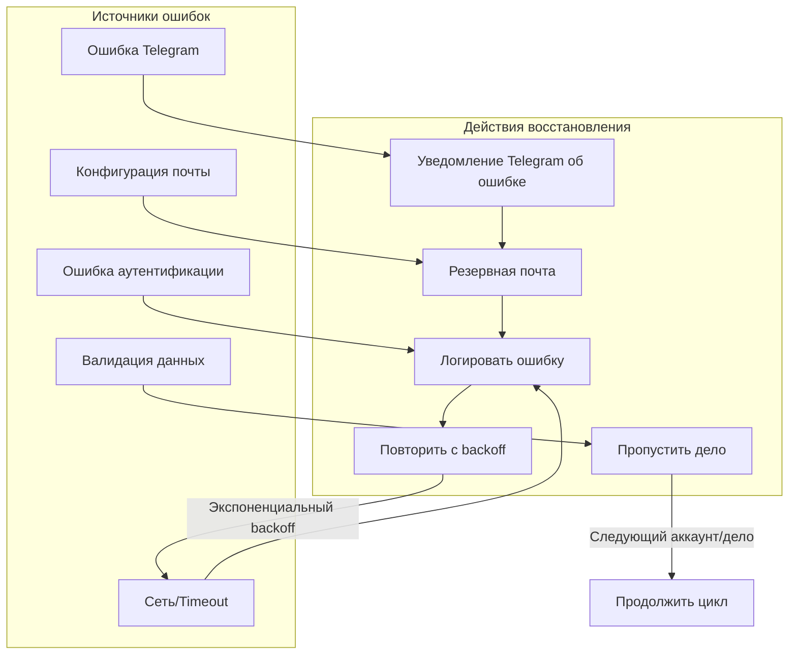
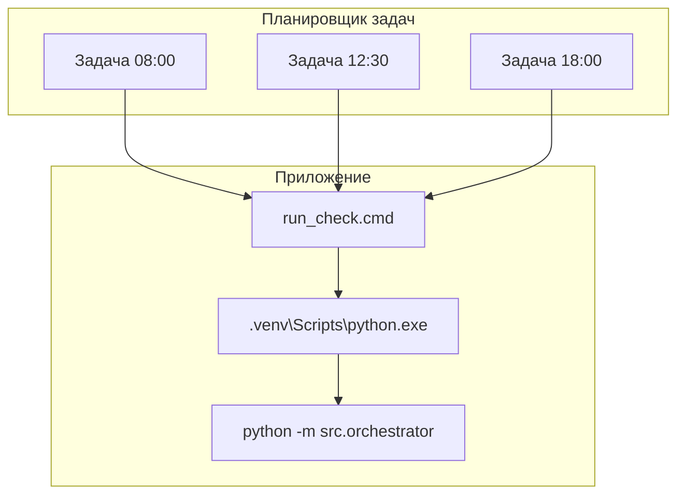

# Inpol Monitor — Диаграммы взаимодействий системы

Подробные диаграммы взаимодействий, основанные на реальной базе кода. Все потоки получены из реализации в `src/`, `.planning/` и архитектуре приложения.

Доступные переводы: [English](../en/system-interactions/SYSTEM_INTERACTIONS.md) | [Polski](../pl/system-interactions/SYSTEM_INTERACTIONS.md) | [Русский](SYSTEM_INTERACTIONS.md) | [Українська](../ua/system-interactions/SYSTEM_INTERACTIONS.md)

---

## 1. Поток аутентификации (последовательная аутентификация с CSRF)



**Ключевые методы** (`src/auth.py`, `src/session_manager.py`):
- `authenticate_account(name, creds)` — точка входа последовательной аутентификации
- `run_sequential_auth()` — обрабатывает все настроенные аккаунты
- `login(email, password)` — выполняет аутентификацию
- `_has_akamai_challenge(html)` — обнаруживает защиту Akamai
- `_solve_challenge(html, url)` — решатель через meta-refresh (~2с ожидания на вызов API)

---

## 2. Поток извлечения данных



**Ключевые методы** (`src/scraper.py`):
- `fetch_case_data(case_id)` — извлекает модель CaseData Pydantic
- `fetch_questions(case_id)` — извлекает данные вопросов со всеми 7 полями
- `fetch_attachments(case_id)` — извлекает вложения документов
- `_resolve_status_label(code)` — маппит коды статусов на читаемые метки
- `_resolve_question_title(id)` — маппит заголовки вопросов через локализацию
- `fetch_all_for_case(case_id)` — координирует полное извлечение данных дела

---

## 3. Поток хранения (только INSERT, неизменяемо)



**Ключевые методы** (`src/storage.py`):
- `save_snapshot(snapshot)` — только INSERT, никогда не обновляет/не удаляет
- `get_latest_snapshot(case_id)` — самый свежий снимок для дела
- `get_previous_snapshot(case_id)` — второй по свежести
- `get_all_snapshots()` — полные исторические записи
- `get_snapshots_by_account(account_id)` — фильтр по аккаунту
- `get_distinct_case_ids()` — глобально уникальные ID дел (STORE-03)
- `get_snapshot_by_id(id)` — получение одиночного снимка

---

## 4. Поток обнаружения изменений (паттерн «Стратегия»)



**7 типов изменений** (`src/models.py` `ChangeType`):
- `STATUS` — изменение кода статуса
- `NEW_DOCUMENT` — добавлен новый документ
- `REMOVED_DOCUMENT` — документ удалён
- `DECISION_DATE_CHANGE` — изменена дата решения
- `SUBMIT_DATE_CHANGE` — изменена дата подачи
- `UPDATED_AT_CHANGE` — изменена метка времени updated_at
- `TIMELINE_EVENT_ADDED` — новое событие таймлайна

А также типы уровня вопросов: `QUESTION_ASKED`, `QUESTION_ANSWERED`, `QUESTION_COUNT_CHANGE`, `NEW_QUESTION_DETAIL`.

**Ключевые методы** (`src/detector.py`):
- `BaseDetector.detect(old, new)` — абстрактный интерфейс стратегии
- Каждый детектор возвращает `List[Change]` (пустой список при отсутствии изменений)
- Корректная обработка `old_snapshot=None` (первый запуск)

---

## 5. Поток уведомлений Telegram (сначала собрать, потом отправить)



**Ключевые методы** (`src/notifier.py`):
- `send_all_notifications()` — итерирует все уведомления в очереди
- `_build_change_message()` — богатое сообщение Markdown с деталями дела
- `_build_single_message()` — сообщение одного дела
- `_build_error_message()` — формат уведомления об ошибке
- `_send_fallback_email()` — запускает резервную почту
- `_tn()` — помощник локализации для ключей уведомлений
- `_resolve_chat_id(user_id)` — маппит ID пользователей на чаты Telegram

---

## 6. Поток резервной почты



**Ключевые методы** (`src/email_notifier.py`):
- `_validate_config()` — проверяет наличие конфигурации SMTP
- `_format_change_email()` — HTML-тело письма с таблицей до/после
- `_format_error_email()` — тело письма об ошибке
- `send_change_notification()` — главная точка входа
- `send_combined_notification()` — объединяет все изменения в одно письмо

---

## 7. Поток веб-интерфейса (Flask)



**Ключевые маршруты** (`src/web/routes.py`): `index`, `login`, `logout`, `compare`, `build_comparison`, `delete`, `set_language`.

**Ключевая аутентификация** (`src/web/auth.py`): `verify_credentials()`, `login_user()` / `logout_user()`, декоратор `login_required`.

---

## 8. Поток локализации / i18n

```mermaid
flowchart TB
    subgraph LF[Файлы языков]
        EN[en.json]
        PL[pl.json]
        RU[ru.json]
        UA[ua.json]
    end

    subgraph L10N[Движок локализации]
        LOAD[load_translations(lang)]
        T[t(key, default, lang)]
        SL[get_status_label(id)]
        QT[get_question_title(id)]
        QS[get_question_status(id)]
        FT[get_file_type(id)]
    end

    subgraph FALLBACK[Резервные карты]
        QTF[_QUESTION_TITLES_FALLBACK]
        QSF[_QUESTION_STATUSES_FALLBACK]
        SF[_STATUSES_FALLBACK]
    end

    LF -->|Читать при старте| LOAD
    LOAD -->|Маппить на| FALLBACK
    LOAD -->|Перезаписать через| Маппинги JSON
    SL --> LOAD
    QT --> LOAD
    QS --> LOAD
    T --> LOAD
    FALLBACK -->|Когда ключ JSON отсутствует| LOAD
```

**Ключевые методы** (`src/localization.py`):
- `load_translations(language)` — загружает JSON-файл для кода языка
- `t(key, default, language)` — переводит ключ локализации
- `get_language()` / `set_language(lang)` — получить/установить текущий язык
- `get_status_label(status_id)` — маппит код статуса на переведённую метку
- `get_question_title(title_id)` — маппит ID заголовка на переведённую метку
- `get_question_status(status_id)` — маппит код статуса на метку статуса
- `get_file_type(file_type_id)` — маппит ID типа файла на метку

**Резервные карты** (`src/models.py`):
- `_QUESTION_TITLES_FALLBACK` — 7 заголовков вопросов
- `_QUESTION_STATUSES_FALLBACK` — 2 статуса вопросов
- `_STATUSES_FALLBACK` — 22 кода статусов

---

## 9. Поток обработки ошибок и восстановления



**Обработка ошибок из базы кода:**

**Из `src/orchestrator.py`:**
- `main()` оборачивает всё в try/except
- При ошибке: `notifier.on_error(account_id, case_id, error, "SYSTEM_ERROR")`
- Уведомление об ошибке отправляется в Telegram

**Из `src/notifier.py`:**
- `on_error()` — отправляет уведомление об ошибке в Telegram
- `_build_error_message()` — форматирует детали ошибки
- `_send_error_fallback_email()` — резервная почта для ошибок

**Из `src/session_manager.py`:**
- `get(url, max_retries=1)` — логика повтора с параметром `max_retries`
- Автоматическое решение челленджей Akamai через meta-refresh (~2с ожидания)
- Логирование ошибок повсюду

**Из `src/detector.py`:**
- Каждый детектор возвращает `List[Change]` (пустой список при отсутствии изменений)
- Исключений при нормальной детекции не возникает
- Корректная обработка `old_snapshot=None` (сценарий первого запуска)

---

## 10. Поток конфигурации

```mermaid
flowchart TD
    subgraph SRC[Источники]
        ENV[Файл .env]
        CRED[credentials.json]
        WEB[веб-учётные данные]
    end

    subgraph CFG[Модуль конфигурации]
        LE[load_env(path)]
        LC[load_credentials(path)]
        GC[get_config(key, default)]
        GA[get_accounts()]
        GS[get_smtp_config()]
        GE[get_email_enabled()]
        GJ[get_json_logging_enabled()]
        GT[get_authorized_telegram_users()]
    end

    subgraph CONSUMERS[Потребители]
        ORCH[orchestrator.py]
        AUTH[auth.py]
        SCR[scraper.py]
        NOT[notifier.py]
        EM[email_notifier.py]
        STO[storage.py]
        WEBAPP[web/routes.py]
    end

    ENV --> LE
    CRED --> LC
    LE --> CFG
    LC --> CFG
    CFG --> CONSUMERS
```

**Ключевые методы** (`src/config.py`):
- `load_env(path)` — загружает файл .env, возвращает успех
- `load_credentials(path)` — загружает credentials.json, возвращает словарь
- `get_base_path()` — получает базовый путь проекта
- `get_config(key, default)` — общий поиск конфигурации
- `get_accounts()` — перечисляет имена настроенных аккаунтов
- `get_smtp_config()` — возвращает словарь SMTP
- `get_email_enabled()` / `get_json_logging_enabled()` — логические значения
- `get_authorized_telegram_users()` — список авторизованных ID пользователей

**Ключи .env** (из README.md):
```
LANGUAGE=en                # Язык веб-интерфейса
NOTIFICATION_LANGUAGE=en   # Язык уведомлений Telegram/почта
INPOL_BASE_URL=https://inpol.mazowieckie.pl
JSON_LOGGING_ENABLED=false
EMAIL_ENABLED=false
SMTP_SERVER=smtp.example.com
SMTP_PORT=587
SMTP_USERNAME=your-username
SMTP_PASSWORD=your-password
EMAIL_FROM=noreply@example.com
EMAIL_TO=your-email@example.com
```

**Формат credentials.json** (из README.md):
```json
{
  "AccountName1": {
    "username": "email@example.com",
    "password": "secure-password",
    "case_ids": ["CASE-001", "CASE-002", "CASE-003"]
  },
  "AccountName2": {
    "username": "email2@example.com",
    "password": "another-password",
    "case_ids": ["CASE-004", "CASE-005"]
  }
}
```

---

## 11. Поток интеграции с Планировщиком задач Windows



**Ключевые команды** (из README.md и `run_check.cmd`):
- Полная команда PowerShell для создания всех 3 задач:
  ```powershell
  $SCRIPT = Join-Path (Get-Location) "run_check.cmd"
  $TASK_NAME = "Inpol Monitor"

  schtasks /Create /TN $TASK_NAME /TR $SCRIPT /SC DAILY /ST 08:00 /F /RL HIGHEST
  schtasks /Create /TN "$TASK_NAME\Noon Check" /TR $SCRIPT /SC DAILY /ST 12:30 /F /RL HIGHEST
  schtasks /Create /TN "$TASK_NAME\Evening Check" /TR $SCRIPT /SC DAILY /ST 18:00 /F /RL HIGHEST
  ```
- Отдельные запросы и запуски задач:
  ```cmd
  schtasks /Query /TN "Inpol Monitor"
  schtasks /Run /TN "Inpol Monitor"
  ```
- Содержимое `run_check.cmd`: `@cd %~dp0 & .venv\Scripts\python -m src.orchestrator`

---

*Основано на реальном коде: `src/orchestrator.py`, `src/auth.py`, `src/session_manager.py`, `src/scraper.py`, `src/storage.py`, `src/detector.py`, `src/notifier.py`, `src/email_notifier.py`, `src/localization.py`, `src/models.py`, `src/config.py`, `src/web/routes.py`, `src/web/auth.py`.*
