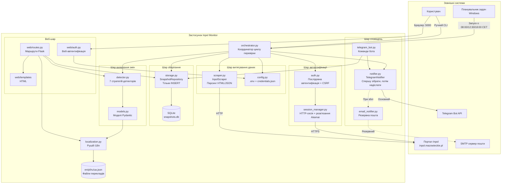
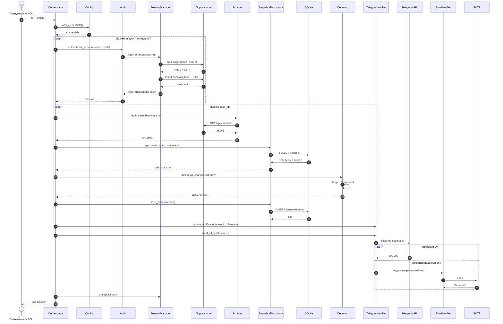
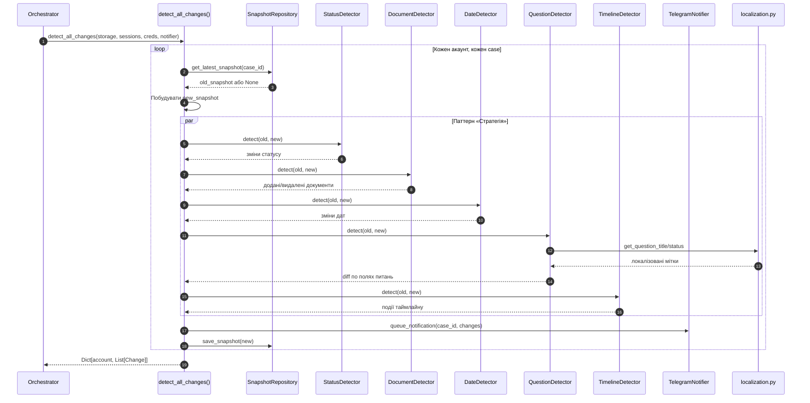
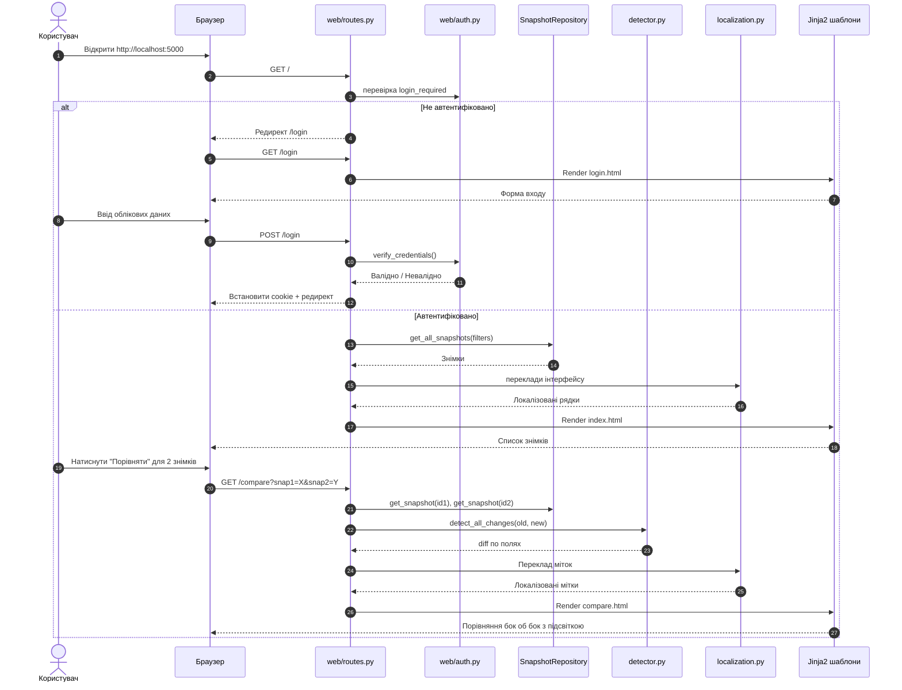
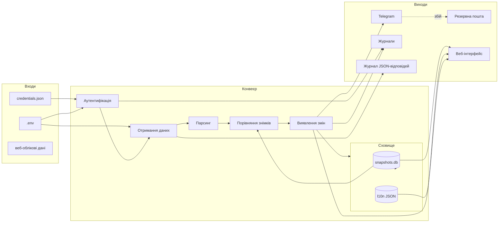
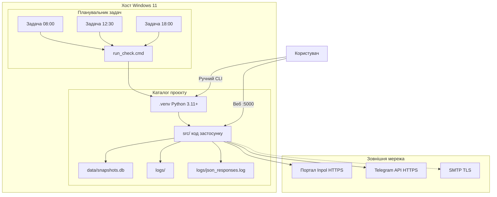

# Inpol Monitor — Діаграми архітектури та взаємодій

Цей документ містить візуальні представлення архітектури системи та взаємодії між компонентами проєкту Inpol Monitor. Діаграми використовують синтаксис Mermaid і відображаються в GitHub, GitLab, VS Code та будь-якому сумісному переглядачу Mermaid.

Доступні переклади: [English](../../en/architecture/ARCHITECTURE.md) | [Polski](../../pl/architecture/ARCHITECTURE.md) | [Русский](../../ru/architecture/ARCHITECTURE.md) | [Українська](ARCHITECTURE.md)

---

## 1. Діаграма компонентів

Загальний вигляд шарів системи та зв'язків між ними.

---

## 2. Діаграма послідовності — головний цикл перевірки

Повний цикл моніторингу, що запускається планувальником задач, ручним CLI або веб-інтерфейсом.

---

## 3. Діаграма послідовності — деталі виявлення змін

Паттерн «Стратегія» для 7 типів змін.

7 типів змін: `STATUS`, `NEW_DOCUMENT`, `REMOVED_DOCUMENT`, `DECISION_DATE_CHANGE`, `SUBMIT_DATE_CHANGE`, `UPDATED_AT_CHANGE`, `TIMELINE_EVENT_ADDED`, а також типи рівня питань (`QUESTION_ASKED`, `QUESTION_ANSWERED`, `QUESTION_COUNT_CHANGE`, `NEW_QUESTION_DETAIL`).

---

## 4. Діаграма послідовності — веб-інтерфейс

Веб-застосунок Flask: вхід, список знімків, порівняння двох знімків.

Ключові маршрути (`src/web/routes.py`): `index`, `login`, `logout`, `compare`, `build_comparison`, `delete`, `set_language`.

---

## 5. Діаграма потоку даних

---

## 6. Діаграма розгортання

---

## 7. Архітектурні паттерни

| Паттерн | Розташування | Опис |
|---------|--------------|----------|
| Strategy | `detector.py` | 7 класів-детекторів реалізують `BaseDetector.detect(old, new)` |
| Repository | `storage.py` | `SnapshotRepository` абстрагує операції SQLite |
| Спершу зібрати, потім надіслати | `notifier.py` | Зібрати всі зміни, надіслати одним повідомленням |
| Ланцюжок резервів | `notifier.py` → `email_notifier.py` | Основний канал — Telegram, резервний — пошта |
| Незмінність тільки INSERT | `storage.py` | Знімки ніколи не оновлюються і не видаляються |
| Впровадження залежностей | `orchestrator.py` | Сховище/сповіщувач/сесії передаються детектору |
| i18n з резервом | `localization.py` + `models.py` | JSON-словники + жорстко задані резервні відповідності |
| Керування сесією | `session_manager.py` | HTTP-сесія + CSRF + розв'язання challenge Akamai через meta-refresh |

---

## 8. Технологічний стек

| Шар | Технологія |
|------|------------|
| Бекенд | Python 3.11+, requests, beautifulsoup4, lxml |
| Моделі | Pydantic v2 |
| Зберігання | SQLite (тільки INSERT, незмінювано) |
| Веб-інтерфейс | Flask 3.0+, Bootstrap 5, HTMX, Jinja2 |
| Сповіщення | aiogram 3.x (Telegram), smtplib (SMTP) |
| Локалізація | JSON i18n (EN/PL/UA/RU) |
| Розгортання | Планувальник задач Windows, Python venv |
| Тестування | pytest, покриття >80% |

---

*Ґрунтується на реальному коді: `src/orchestrator.py`, `src/auth.py`, `src/session_manager.py`, `src/scraper.py`, `src/storage.py`, `src/detector.py`, `src/notifier.py`, `src/email_notifier.py`, `src/localization.py`, `src/models.py`, `src/web/routes.py`, `src/web/auth.py`.*
