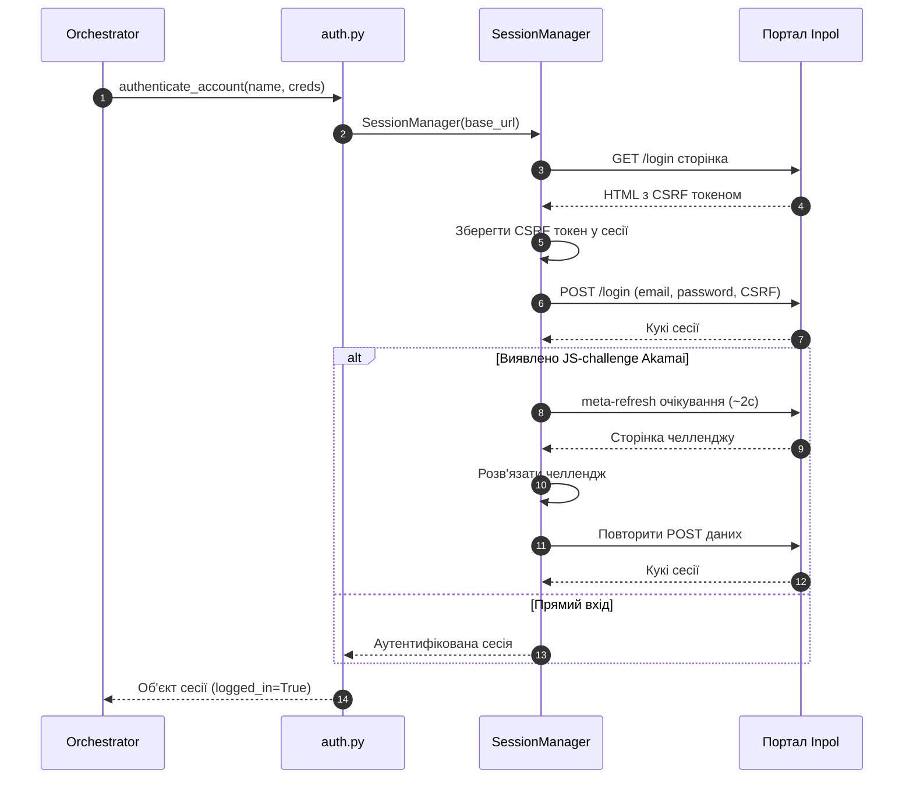
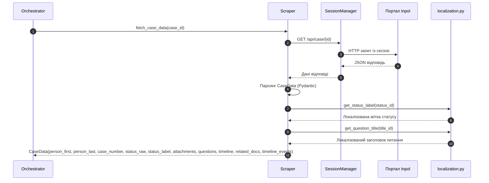
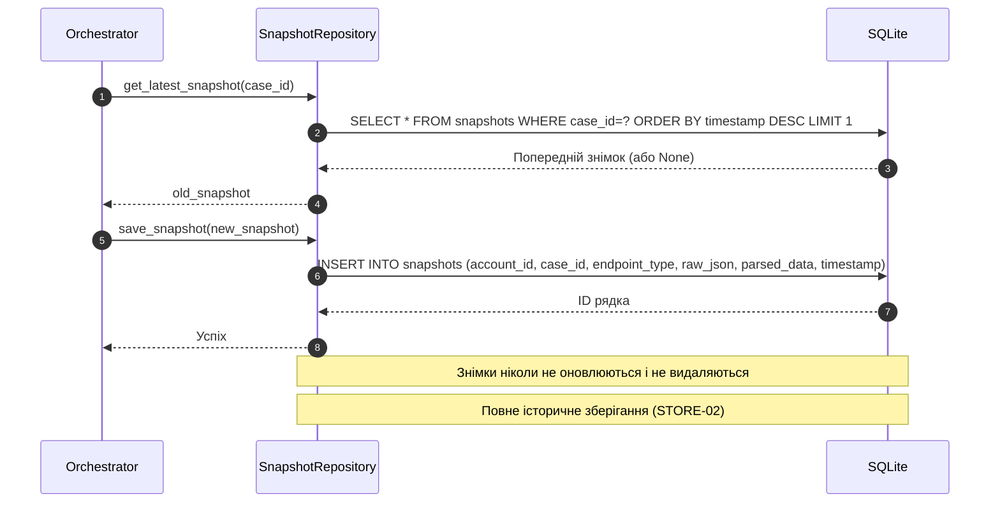
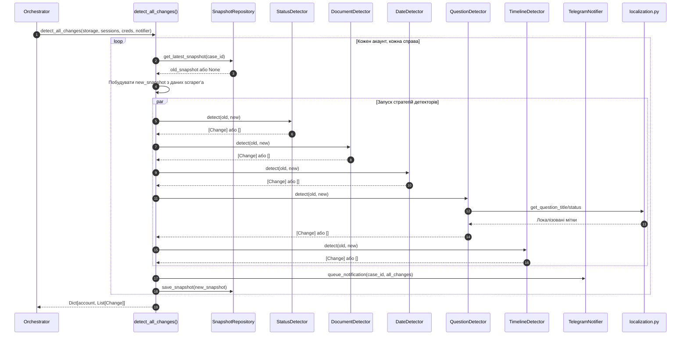
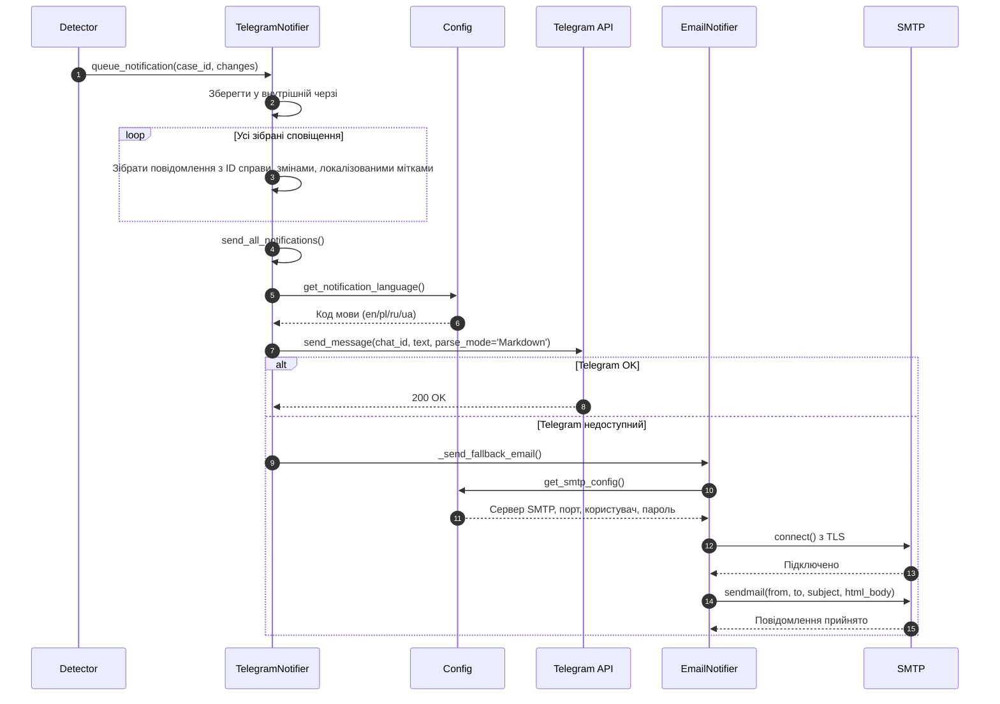
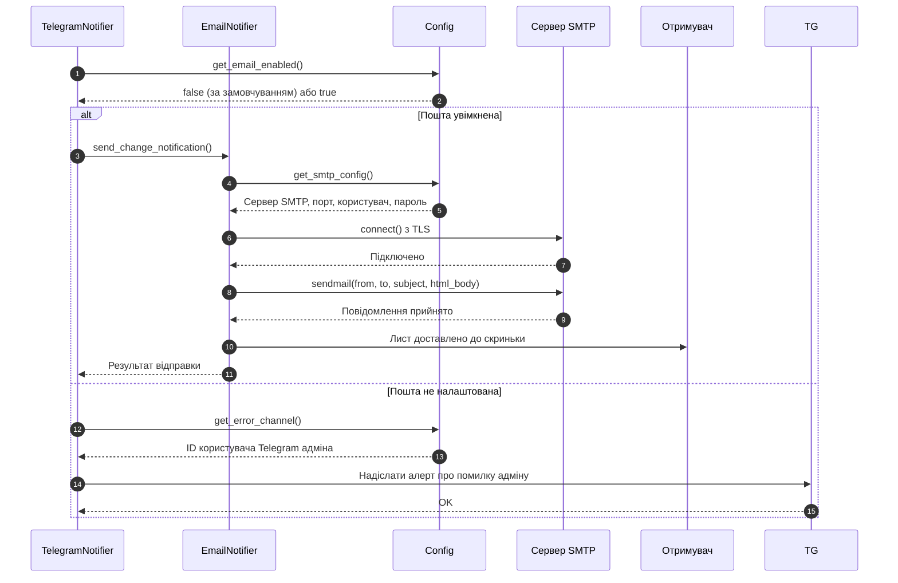
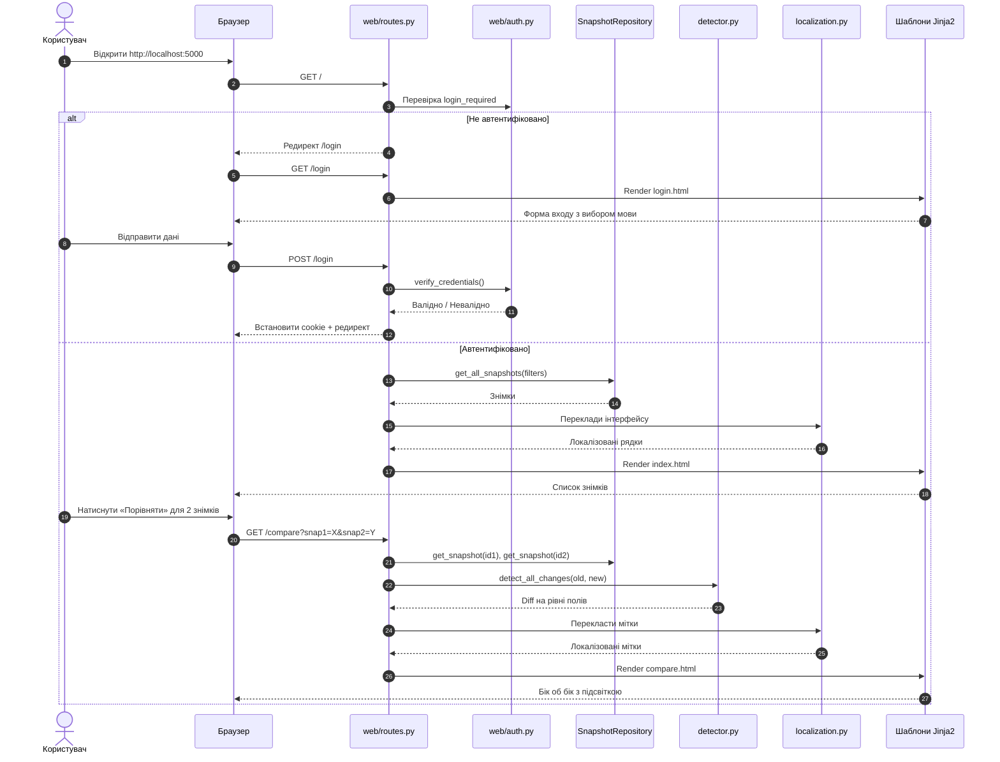
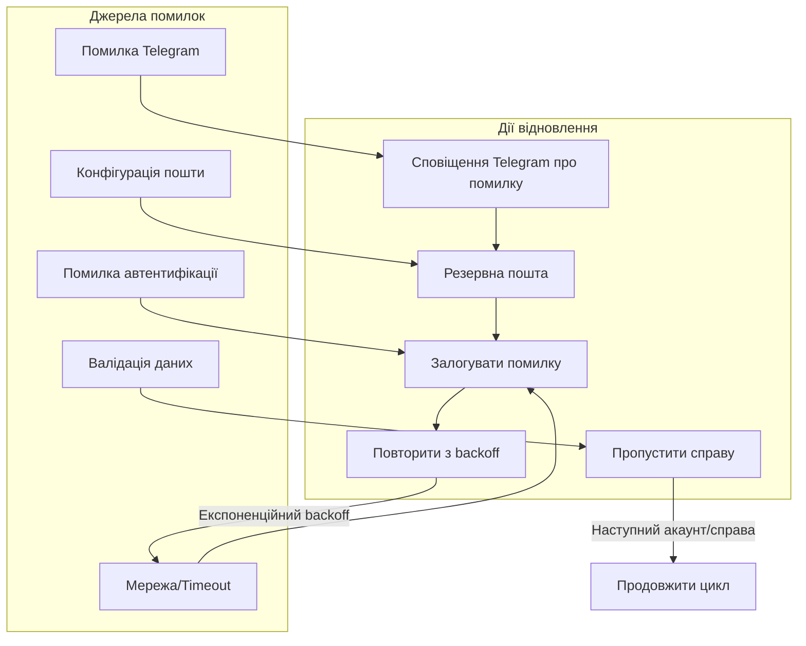
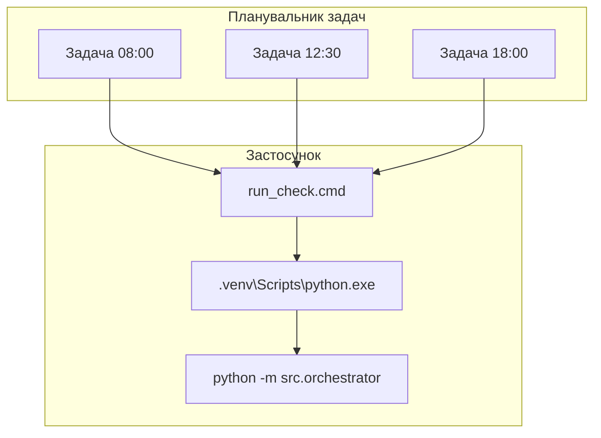

# Inpol Monitor — Діаграми взаємодій системи

Детальні діаграми взаємодій, засновані на реальній базі коду. Усі потоки отримано з реалізації в `src/`, `.planning/` та архітектурі застосунку.

Доступні переклади: [English](../en/system-interactions/SYSTEM_INTERACTIONS.md) | [Polski](../pl/system-interactions/SYSTEM_INTERACTIONS.md) | [Русский](../ru/system-interactions/SYSTEM_INTERACTIONS.md) | [Українська](SYSTEM_INTERACTIONS.md)

---

## 1. Потік автентифікації (послідовна автентифікація з CSRF)



**Ключові методи** (`src/auth.py`, `src/session_manager.py`):
- `authenticate_account(name, creds)` — точка входу послідовної автентифікації
- `run_sequential_auth()` — обробляє всі налаштовані акаунти
- `login(email, password)` — виконує автентифікацію
- `_has_akamai_challenge(html)` — виявляє захист Akamai
- `_solve_challenge(html, url)` — розв'язувач через meta-refresh (~2с очікування на виклик API)

---

## 2. Потік витягування даних



**Ключові методи** (`src/scraper.py`):
- `fetch_case_data(case_id)` — витягує модель CaseData Pydantic
- `fetch_questions(case_id)` — витягує дані питань із всіма 7 полями
- `fetch_attachments(case_id)` — витягує вкладення документів
- `_resolve_status_label(code)` — мапить коди статусів на зрозумілі мітки
- `_resolve_question_title(id)` — мапить заголовки питань через локалізацію
- `fetch_all_for_case(case_id)` — коорординує повне отримання даних справи

---

## 3. Потік зберігання (тільки INSERT, незмінне)



**Ключові методи** (`src/storage.py`):
- `save_snapshot(snapshot)` — тільки INSERT, ніколи не оновлює/не видаляє
- `get_latest_snapshot(case_id)` — найсвіжіший знімок для справи
- `get_previous_snapshot(case_id)` — другий найсвіжіший
- `get_all_snapshots()` — повні історичні записи
- `get_snapshots_by_account(account_id)` — фільтр за акаунтом
- `get_distinct_case_ids()` — глобально унікальні ID справ (STORE-03)
- `get_snapshot_by_id(id)` — отримання одного знімка

---

## 4. Потік виявлення змін (паттерн «Стратегія»)



**7 типів змін** (`src/models.py` `ChangeType`):
- `STATUS` — зміна коду статусу
- `NEW_DOCUMENT` — додано новий документ
- `REMOVED_DOCUMENT` — документ видалено
- `DECISION_DATE_CHANGE` — змінено дату рішення
- `SUBMIT_DATE_CHANGE` — змінено дату подачі
- `UPDATED_AT_CHANGE` — змінено мітку часу updated_at
- `TIMELINE_EVENT_ADDED` — нову подію таймлайну

А також типи рівня питань: `QUESTION_ASKED`, `QUESTION_ANSWERED`, `QUESTION_COUNT_CHANGE`, `NEW_QUESTION_DETAIL`.

**Ключові методи** (`src/detector.py`):
- `BaseDetector.detect(old, new)` — абстрактний інтерфейс стратегії
- Кожен детектор повертає `List[Change]` (пустий список при відсутності змін)
- М'яка обробка `old_snapshot=None` (сценарій першого запуску)

---

## 5. Потік сповіщень Telegram (спершу зібрати, потім надіслати)



**Ключові методи** (`src/notifier.py`):
- `send_all_notifications()` — ітерує всі сповіщення у черзі
- `_build_change_message()` — багате повідомлення Markdown з деталями справи
- `_build_single_message()` — повідомлення однієї справи
- `_build_error_message()` — формат сповіщення про помилку
- `_send_fallback_email()` — запускає резервну пошту
- `_tn()` — помічник локалізації для ключів сповіщень
- `_resolve_chat_id(user_id)` — мапить ID користувачів на чати Telegram

---

## 6. Потік резервної пошти



**Ключові методи** (`src/email_notifier.py`):
- `_validate_config()` — перевіряє наявність конфігурації SMTP
- `_format_change_email()` — HTML-тело листа з таблицею до/після
- `_format_error_email()` — тіло листа про помилку
- `send_change_notification()` — головна точка входу
- `send_combined_notification()` — об'єднує всі зміни в одному листі

---

## 7. Потік веб-інтерфейсу (Flask)



**Ключові маршрути** (`src/web/routes.py`): `index`, `login`, `logout`, `compare`, `build_comparison`, `delete`, `set_language`.

**Ключова автентифікація** (`src/web/auth.py`): `verify_credentials()`, `login_user()` / `logout_user()`, декоратор `login_required`.

---

## 8. Потік локалізації / i18n

```mermaid
flowchart TB
    subgraph LF[Файли мов]
        EN[en.json]
        PL[pl.json]
        RU[ru.json]
        UA[ua.json]
    end

    subgraph L10N[Рушій локалізації]
        LOAD[load_translations(lang)]
        T[t(key, default, lang)]
        SL[get_status_label(id)]
        QT[get_question_title(id)]
        QS[get_question_status(id)]
        FT[get_file_type(id)]
    end

    subgraph FALLBACK[Резервні карти]
        QTF[_QUESTION_TITLES_FALLBACK]
        QSF[_QUESTION_STATUSES_FALLBACK]
        SF[_STATUSES_FALLBACK]
    end

    LF -->|Читати при старті| LOAD
    LOAD -->|Мапити на| FALLBACK
    LOAD -->|Перезаписати через| Мапінги JSON
    SL --> LOAD
    QT --> LOAD
    QS --> LOAD
    T --> LOAD
    FALLBACK -->|Коли ключ JSON відсутній| LOAD
```

**Ключові методи** (`src/localization.py`):
- `load_translations(language)` — завантажує JSON-файл для коду мови
- `t(key, default, language)` — перекладає ключ локалізації
- `get_language()` / `set_language(lang)` — отримати/встановити поточну мову
- `get_status_label(status_id)` — мапить код статусу на перекладену мітку
- `get_question_title(title_id)` — мапить ID заголовка на перекладену мітку
- `get_question_status(status_id)` — мапить код статусу на мітку статусу
- `get_file_type(file_type_id)` — мапить ID типу файлу на мітку

**Резервні карти** (`src/models.py`):
- `_QUESTION_TITLES_FALLBACK` — 7 заголовків питань
- `_QUESTION_STATUSES_FALLBACK` — 2 статуси питань
- `_STATUSES_FALLBACK` — 22 коди статусів

---

## 9. Потік обробки помилок і відновлення



**Обробка помилок із бази коду:**

**З `src/orchestrator.py`:**
- `main()` оборачує все в try/except
- При помилці: `notifier.on_error(account_id, case_id, error, "SYSTEM_ERROR")`
- Сповіщення про помилку надсилається в Telegram

**З `src/notifier.py`:**
- `on_error()` — надсилає сповіщення про помилку в Telegram
- `_build_error_message()` — форматує деталі помилки
- `_send_error_fallback_email()` — резервна пошта для помилок

**З `src/session_manager.py`:**
- `get(url, max_retries=1)` — логіка повтору з параметром `max_retries`
- Автоматичне розв'язання челленджів Akamai через meta-refresh (~2с очікування)
- Логування помилок всюди

**З `src/detector.py`:**
- Кожен детектор повертає `List[Change]` (пустий список при відсутності змін)
- Винятків при нормальній детекції не виникає
- Коректна обробка `old_snapshot=None` (сценарій першого запуску)

---

## 10. Потік конфігурації

```mermaid
flowchart TD
    subgraph SRC[Джерела]
        ENV[Файл .env]
        CRED[credentials.json]
        WEB[веб-облікові дані]
    end

    subgraph CFG[Модуль конфігурації]
        LE[load_env(path)]
        LC[load_credentials(path)]
        GC[get_config(key, default)]
        GA[get_accounts()]
        GS[get_smtp_config()]
        GE[get_email_enabled()]
        GJ[get_json_logging_enabled()]
        GT[get_authorized_telegram_users()]
    end

    subgraph CONSUMERS[Споживачі]
        ORCH[orchestrator.py]
        AUTH[auth.py]
        SCR[scraper.py]
        NOT[notifier.py]
        EM[email_notifier.py]
        STO[storage.py]
        WEBAPP[web/routes.py]
    end

    ENV --> LE
    CRED --> LC
    LE --> CFG
    LC --> CFG
    CFG --> CONSUMERS
```

**Ключові методи** (`src/config.py`):
- `load_env(path)` — завантажує файл .env, повертає успіх
- `load_credentials(path)` — завантажує credentials.json, повертає словник
- `get_base_path()` — отримує базовий шлях проєкту
- `get_config(key, default)` — загальний пошук конфігурації
- `get_accounts()` — перелічує імена налаштованих акаунтів
- `get_smtp_config()` — повертає словник SMTP
- `get_email_enabled()` / `get_json_logging_enabled()` — логічні значення
- `get_authorized_telegram_users()` — список авторизованих ID користувачів

**Ключі .env** (з README.md):
```
LANGUAGE=en                # Мова веб-інтерфейсу
NOTIFICATION_LANGUAGE=en   # Мова сповіщень Telegram/пошта
INPOL_BASE_URL=https://inpol.mazowieckie.pl
JSON_LOGGING_ENABLED=false
EMAIL_ENABLED=false
SMTP_SERVER=smtp.example.com
SMTP_PORT=587
SMTP_USERNAME=your-username
SMTP_PASSWORD=your-password
EMAIL_FROM=noreply@example.com
EMAIL_TO=your-email@example.com
```

**Формат credentials.json** (з README.md):
```json
{
  "AccountName1": {
    "username": "email@example.com",
    "password": "secure-password",
    "case_ids": ["CASE-001", "CASE-002", "CASE-003"]
  },
  "AccountName2": {
    "username": "email2@example.com",
    "password": "another-password",
    "case_ids": ["CASE-004", "CASE-005"]
  }
}
```

---

## 11. Потік інтеграції з Планувальником задач Windows



**Ключові команди** (з README.md та `run_check.cmd`):
- Повна команда PowerShell для створення всіх 3 задач:
  ```powershell
  $SCRIPT = Join-Path (Get-Location) "run_check.cmd"
  $TASK_NAME = "Inpol Monitor"

  schtasks /Create /TN $TASK_NAME /TR $SCRIPT /SC DAILY /ST 08:00 /F /RL HIGHEST
  schtasks /Create /TN "$TASK_NAME\Noon Check" /TR $SCRIPT /SC DAILY /ST 12:30 /F /RL HIGHEST
  schtasks /Create /TN "$TASK_NAME\Evening Check" /TR $SCRIPT /SC DAILY /ST 18:00 /F /RL HIGHEST
  ```
- Окремі запити та запуски задач:
  ```cmd
  schtasks /Query /TN "Inpol Monitor"
  schtasks /Run /TN "Inpol Monitor"
  ```
- Зміст `run_check.cmd`: `@cd %~dp0 & .venv\Scripts\python -m src.orchestrator`

---

*Ґрунтується на реальному коді: `src/orchestrator.py`, `src/auth.py`, `src/session_manager.py`, `src/scraper.py`, `src/storage.py`, `src/detector.py`, `src/notifier.py`, `src/email_notifier.py`, `src/localization.py`, `src/models.py`, `src/config.py`, `src/web/routes.py`, `src/web/auth.py`.*
